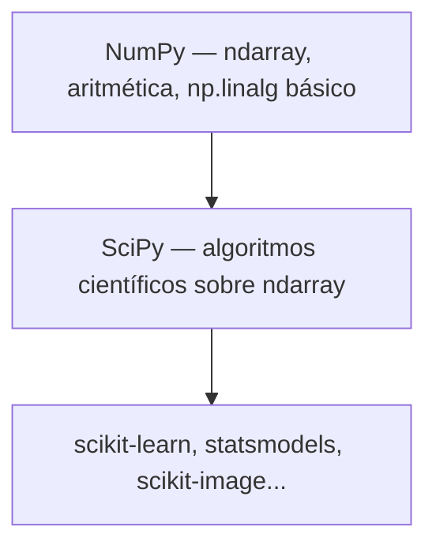

# 01 — Introducción y Arquitectura

> Para el panorama conceptual de dónde encaja SciPy en el ecosistema, ver [[Machine Learning/07-Librerias-de-Data-Science-y-ML#SciPy|Machine Learning/07]]. Para el array base que SciPy extiende, ver [[Python/NumPy/01 - Introducción y Arquitectura Interna|NumPy]].

## ¿Qué es SciPy y qué problema resuelve?

**SciPy** ("Scientific Python") es una biblioteca de algoritmos científicos y matemáticos construida directamente sobre el `ndarray` de NumPy. Donde NumPy provee la estructura de datos (arrays) y las operaciones básicas (aritmética, álgebra lineal elemental, broadcasting), SciPy provee **todo lo que queda fuera**: optimización, estadística avanzada, procesamiento de señales, interpolación, ecuaciones diferenciales, matrices dispersas, datos espaciales.

La relación es de capas:



No es una librería de Machine Learning: no tiene la noción de "entrenar un modelo con datos etiquetados". Es una caja de herramientas de propósito general que **scikit-learn, statsmodels y muchas otras librerías usan internamente** — al llamar `model.fit()` en scikit-learn, es común que por debajo se ejecute una rutina de optimización de `scipy.optimize`.

## Instalación

```bash
pip install scipy
```

## Organización en submódulos

A diferencia de NumPy (una API relativamente plana), SciPy está dividido en submódulos independientes que **deben importarse explícitamente** — `import scipy` por sí solo no da acceso a las funciones:

```python
import scipy               # no expone scipy.stats, scipy.optimize, etc. directamente
scipy.stats                # AttributeError

from scipy import stats    # correcto
import scipy.optimize as opt   # correcto
```

| Submódulo | Qué contiene | Archivo de este cheat-sheet |
|---|---|---|
| `scipy.linalg` | Álgebra lineal avanzada (más completa que `np.linalg`) | 02 |
| `scipy.optimize` | Minimización, ajuste de curvas, búsqueda de raíces | 03 |
| `scipy.stats` | Distribuciones de probabilidad, pruebas de hipótesis | 04, 05 |
| `scipy.interpolate` | Interpolación 1D/2D/N-D | 06 |
| `scipy.integrate` | Integración numérica, ecuaciones diferenciales | 07 |
| `scipy.signal` | Filtros, convolución, análisis espectral | 08 |
| `scipy.sparse` | Matrices dispersas y álgebra lineal dispersa | 09 |
| `scipy.spatial` | Distancias, KDTree, diagramas de Voronoi | 10 |
| `scipy.fft` | Transformada rápida de Fourier | 11 |

## Convención universal: entrada y salida en `ndarray`

Toda la API de SciPy recibe y devuelve arrays de NumPy — no introduce su propia estructura de datos. Esto significa que cualquier función de SciPy se integra sin fricción en un pipeline que ya usa NumPy/Pandas:

```python
import numpy as np
from scipy import stats

datos = np.array([2.1, 2.5, 2.3, 2.8, 2.2, 2.6])
z_scores = stats.zscore(datos)   # ndarray de entrada -> ndarray de salida
```

## `scipy.constants` — constantes físicas y matemáticas

Un submódulo pequeño pero útil que suele pasarse por alto:

```python
from scipy import constants

constants.pi          # 3.14159...
constants.c           # velocidad de la luz (m/s)
constants.Avogadro    # número de Avogadro
constants.convert_temperature(100, 'Celsius', 'Kelvin')   # 373.15
```

## Cuándo SciPy es la herramienta correcta

- El problema requiere un algoritmo numérico estándar (optimización, integración, interpolación) que sería un error reimplementar desde cero.
- Se necesita una distribución de probabilidad o una prueba estadística que NumPy no ofrece.
- Se trabaja con matrices grandes y mayoritariamente ceros (`scipy.sparse`) donde un array denso de NumPy desperdiciaría memoria.

Cuándo **no** es la herramienta correcta: cuando se necesita entrenar un modelo predictivo con datos etiquetados (usar scikit-learn), o cuando se necesita un modelo estadístico con interpretación de coeficientes e inferencia (usar `statsmodels`, que internamente se apoya en `scipy.stats`).
