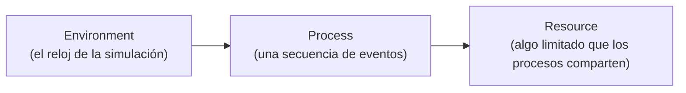

# 01 — Introducción y Conceptos Fundamentales

> Para el panorama conceptual de dónde encaja SimPy, ver [[Machine Learning/07-Librerias-de-Data-Science-y-ML#SimPy|Machine Learning/07]] — relevante especialmente para modelado de capacidad en contextos de Workforce Management (WFM).

## ¿Qué es SimPy y qué problema resuelve?

**SimPy** es una librería de **simulación de eventos discretos** (Discrete Event Simulation, DES): modela sistemas donde ocurren eventos en momentos específicos del tiempo (un cliente llega, un servidor termina de atender, una pieza avanza en una línea de producción), y permite estudiar el comportamiento del sistema simulándolo en vez de observarlo en la vida real.

No es una librería de análisis de datos históricos ni de Machine Learning: en vez de aprender de datos ya observados, **genera** datos hipotéticos ejecutando un modelo del sistema hacia adelante en el tiempo. Responde preguntas del tipo "¿qué pasaría si aumentamos la dotación de agentes en un 20%?" o "¿cuánto tiempo de espera promedio tendría un cliente si agregamos una segunda caja?" — antes de implementar el cambio en la realidad.

## Instalación

```bash
pip install simpy
```

## Los tres conceptos centrales



- **`Environment`**: el entorno de simulación — mantiene el "reloj" virtual y coordina cuándo ocurre cada evento.
- **`Process`**: una función generadora de Python que describe una secuencia de eventos en el tiempo (por ejemplo, "un cliente llega, espera su turno, es atendido, se va").
- **`Resource`**: algo con capacidad limitada que los procesos compiten por usar (un cajero, una máquina, una mesa).

## El ejemplo mínimo

```python
import simpy

def proceso_simple(env):
    print(f"Inicio en t={env.now}")
    yield env.timeout(5)   # el proceso "espera" 5 unidades de tiempo simulado
    print(f"Fin en t={env.now}")

env = simpy.Environment()
env.process(proceso_simple(env))   # registra el proceso, no lo ejecuta todavía
env.run()                           # ejecuta la simulación hasta que no queden eventos pendientes

# Inicio en t=0
# Fin en t=5
```

Piezas clave de este ejemplo:

- Un proceso es una función generadora (usa `yield`, no `return`).
- `env.timeout(n)` es el evento más básico: "espera `n` unidades de tiempo simulado antes de continuar".
- `env.now` da la hora actual **dentro de la simulación** — no tiene relación con el reloj real de la computadora.
- `env.run()` avanza el reloj de evento en evento hasta que no queda nada programado (o hasta un límite, ver abajo).

## Controlar la duración de la simulación

```python
env.run(until=100)   # correr hasta t=100, aunque queden procesos pendientes después de ese punto
```

## Tiempos aleatorios: el corazón de casi toda simulación real

En la práctica, los tiempos entre eventos casi nunca son fijos — se modelan con distribuciones de probabilidad, la misma conexión con [[University Degree Notes/Ciclo 04/Estadística Inferencial/Clase 04 - Cinco Distribuciones Continuas#Distribución Exponencial|la distribución Exponencial]] vista en Estadística Inferencial para el tiempo entre llegadas:

```python
import random

def llegada_cliente(env):
    while True:
        yield env.timeout(random.expovariate(1/5))   # tiempo entre llegadas ~ Exponencial(media=5 min)
        print(f"Cliente llega en t={env.now:.2f}")

env = simpy.Environment()
env.process(llegada_cliente(env))
env.run(until=20)
```

## Ver también

- [[02 - Recursos (Resource, Container, Store)]]
- [[03 - Modelado de Colas]]
