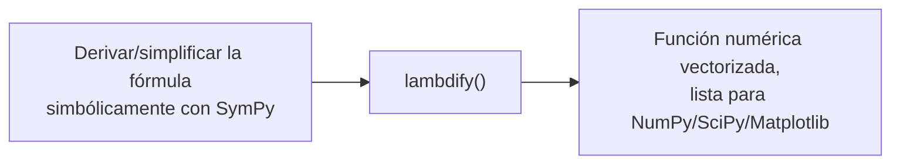

# 07 — De lo Simbólico a lo Numérico (`lambdify`)

## El puente entre SymPy y NumPy

Evaluar una expresión simbólica repetidamente con `.subs()` es correcto pero **lento** — cada llamada reconstruye la expresión internamente. Cuando se necesita evaluar la misma fórmula miles o millones de veces (por ejemplo, sobre un array completo de NumPy), `lambdify` compila la expresión simbólica a una función Python normal, vectorizada, tan rápida como si se hubiera escrito directamente en NumPy.

```python
import sympy as sp
import numpy as np

x = sp.symbols('x')
expr = x**3 - 2*x + 1

f_lenta = lambda valor: expr.subs(x, valor)    # funciona, pero evalúa símbolo por símbolo -- lento sobre arrays grandes
f_rapida = sp.lambdify(x, expr, 'numpy')       # compila a una función NumPy vectorizada

xs = np.linspace(-5, 5, 1_000_000)
f_rapida(xs)   # evalúa el millón de puntos de una vez, vectorizado -- práctico para uso real
```

## El flujo de trabajo típico

Este es el patrón central que justifica tener SymPy y NumPy en el mismo proyecto:



**Ejemplo completo:** derivar simbólicamente el gradiente de una función de costo y luego evaluarlo rápido sobre datos reales:

```python
x, a, b = sp.symbols('x a b')
costo = (a * x + b - 5)**2   # función de costo de ejemplo

gradiente = sp.diff(costo, x)                    # derivada simbólica
gradiente_numerico = sp.lambdify((x, a, b), gradiente, 'numpy')

gradiente_numerico(2.0, 1.5, 0.3)   # evaluación numérica rápida, lista para un loop de optimización
```

## Múltiples variables y funciones vectoriales

```python
x, y = sp.symbols('x y')
f = sp.Matrix([x**2 + y, sp.sin(x * y)])

f_numerica = sp.lambdify((x, y), f, 'numpy')
f_numerica(1.0, 2.0)   # devuelve un array NumPy de 2 elementos
```

## El argumento del backend (`'numpy'`, `'scipy'`, `'math'`)

```python
sp.lambdify(x, sp.sin(x), 'numpy')   # usa np.sin -- acepta arrays, vectorizado
sp.lambdify(x, sp.sin(x), 'math')    # usa math.sin -- solo escalares, ligeramente más rápido para un solo valor
```

Para uso con arrays de NumPy (el caso general en ciencia de datos), siempre especificar `'numpy'` explícitamente en vez de dejar el backend por defecto.

## Ver también

- [[01 - Introducción y Filosofía]]
- [[Python/NumPy/10 - Operaciones Matemáticas y Vectorización]]
- [[Python/SciPy/03 - Optimización (scipy.optimize)]]
