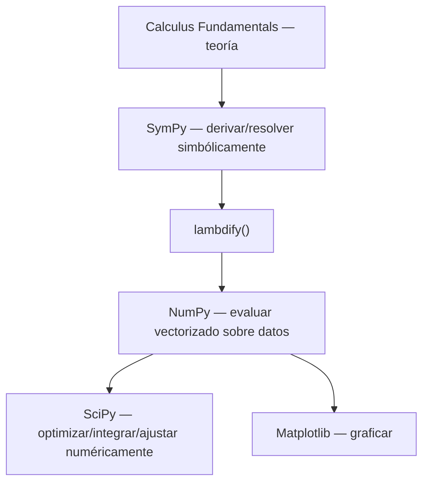

# 08 — Integración con el Ecosistema y Comparativa

## Resumen del flujo de trabajo con el resto del stack



## NumPy

Sin integración directa a nivel de tipos (un `Symbol` no es un `ndarray`) — el puente es siempre [[07 - De lo Simbólico a lo Numérico (lambdify)|`lambdify`]]. No hay forma de pasar un array de NumPy directamente a una función simbólica sin antes convertir la expresión.

## SciPy

Cuando SymPy no puede resolver algo simbólicamente (una integral sin forma cerrada, una ecuación diferencial sin solución analítica), la vía es lambdify + SciPy numérico:

```python
import sympy as sp

x = sp.symbols('x')
integral_simbolica = sp.integrate(sp.exp(-x**2), x)   # SymPy no encuentra forma cerrada -> devuelve Integral sin evaluar

# Alternativa: integración numérica directa con SciPy
from scipy.integrate import quad
import numpy as np
resultado, error = quad(lambda x: np.exp(-x**2), -np.inf, np.inf)   # sqrt(pi), numéricamente
```

## Jupyter / notebooks

`sp.init_printing()` activa renderizado LaTeX automático de las expresiones en la salida de una celda — el uso más común de SymPy en la práctica es exploratorio, dentro de un notebook, alternando celdas de álgebra simbólica con celdas de verificación numérica.

## SymPy vs herramientas de álgebra computacional externas (Mathematica, Maple, WolframAlpha)

| | SymPy | Mathematica / Maple |
|---|---|---|
| Costo | Gratuito, open source | Licencia comercial |
| Rendimiento en cómputo simbólico pesado | Más lento | Generalmente más rápido (motores más maduros) |
| Integración con Python | Nativa | Requiere puente/API |
| Cobertura de casos avanzados | Buena, con huecos en áreas muy especializadas | Más exhaustiva |

Para el uso típico en ciencia de datos e ingeniería (derivar una fórmula, resolver una ecuación, verificar un cálculo) SymPy es suficiente y evita depender de software con licencia; para investigación matemática pura con expresiones extremadamente complejas, las herramientas comerciales aún tienen ventaja.

## Cuándo NO usar SymPy

- Cuando el problema ya es puramente numérico desde el inicio (datos reales, sin fórmula que derivar antes) — usar NumPy/SciPy directamente.
- Cuando se necesita rendimiento sobre volúmenes grandes de datos — SymPy no está diseñado para eso, ni siquiera con `lambdify` (que solo acelera la *evaluación* de una fórmula ya derivada, no el álgebra simbólica en sí).

## Ver también

- [[01 - Introducción y Filosofía]]
- [[Python/SciPy/01 - Introducción y Arquitectura]]
- [[Calculus Fundamentals/Derivadas e Integrales Fundamentales]]
