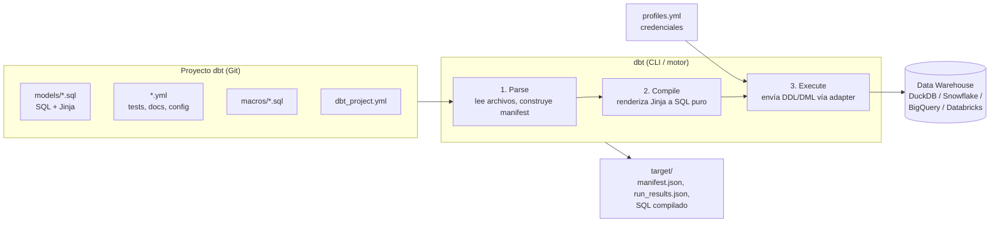
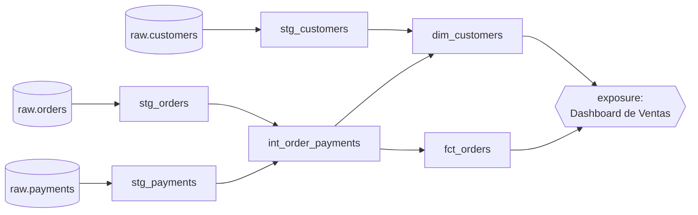

# 01 — Introducción y Arquitectura

> Este cheat-sheet es la referencia práctica de dbt. Para el panorama conceptual de dónde encaja dbt dentro de la ingeniería de datos (ETL vs. ELT, warehouses, orquestadores), ver [[04-Ingenieria-de-Datos#dbt (_data build tool_)|04-Ingenieria-de-Datos]] en `Machine Learning/`; para el rol profesional que dbt popularizó, ver [[02-Roles-y-Carreras-en-DS-ML#Analytics Engineer|Analytics Engineer]].

## ¿Qué problema resuelve dbt?

En un stack moderno **ELT**, los datos crudos ya están cargados en el warehouse (por Fivetran, Airbyte, un script de Python, etc.). Falta la **T**: convertir esas tablas crudas en tablas limpias, modeladas y confiables para dashboards, reportes y modelos de ML.

Antes de dbt, esa transformación vivía en:

- Scripts `.sql` sueltos ejecutados a mano o por cron, sin orden de dependencias explícito.
- Stored procedures dentro del warehouse, difíciles de versionar y de testear.
- Herramientas ETL gráficas (SSIS, Informatica, Talend) donde la lógica queda atrapada en una interfaz.

**dbt (data build tool)** propone algo muy simple: **cada transformación es un archivo `SELECT`**. dbt se encarga de todo lo demás:

| Lo que tú escribes | Lo que dbt hace por ti |
|---|---|
| Un `SELECT` en `models/fct_orders.sql` | Genera el `CREATE TABLE AS` / `CREATE VIEW AS` / `MERGE` correcto para tu warehouse |
| `{{ ref('stg_orders') }}` en vez de un nombre de tabla | Construye el **DAG** de dependencias y ejecuta en orden |
| Un YAML con `unique` y `not_null` | Genera y ejecuta queries de testing |
| Descripciones en YAML | Genera un sitio web de documentación con lineage |
| `target: dev` vs. `target: prod` | Escribe en esquemas distintos sin cambiar el código |

La idea central: **aplicar las prácticas de ingeniería de software (Git, code review, testing, CI/CD, modularidad, documentación) a las transformaciones SQL**.

## Lo que dbt NO es

Es importante entender sus límites desde el principio:

- **No extrae ni carga datos** (no es Fivetran ni Airbyte). Solo transforma lo que ya está en el warehouse. La excepción menor son los **seeds** (CSVs pequeños), ver [[05 - Sources y Seeds]].
- **No es un motor de cómputo.** dbt no procesa datos: compila SQL y se lo envía al warehouse (Snowflake, BigQuery, DuckDB...). Todo el trabajo pesado lo hace el warehouse.
- **No es un orquestador general.** Ordena sus propios modelos, pero para programar ejecuciones junto con extracción, ML y alertas se combina con Airflow, Prefect o Dagster (ver [[15 - dbt en Producción - CI-CD y Orquestación]]).
- **No es una herramienta de BI.** Produce las tablas que Power BI o Tableau consumen.

## Arquitectura: cómo funciona por dentro



### Las tres fases

1. **Parse:** dbt lee todos los `.sql`, `.yml` y `.py` del proyecto y construye un grafo en memoria: el **manifest** (`target/manifest.json`). Aquí detecta cada `ref()` y `source()` para saber quién depende de quién.
2. **Compile:** renderiza el Jinja de cada modelo. `{{ ref('stg_orders') }}` se convierte en `"dev"."main"."stg_orders"`; los `` se expanden; las macros se resuelven. El resultado es SQL puro que puedes ver en `target/compiled/`.
3. **Execute:** envuelve el SQL compilado en el DDL de la materialización (por ejemplo `create table ... as (select ...)`) y lo ejecuta en el warehouse a través del **adapter**, respetando el orden topológico del DAG y paralelizando con `threads`. El SQL final ejecutado queda en `target/run/`.

### Adapters

Un **adapter** es el plugin que traduce las abstracciones de dbt al dialecto de un warehouse concreto. Desde dbt 1.8, `dbt-core` y los adapters se instalan por separado:

| Adapter | Paquete pip | Uso típico |
|---|---|---|
| DuckDB | `dbt-duckdb` | Desarrollo local, aprendizaje, pipelines pequeños sobre Parquet |
| PostgreSQL | `dbt-postgres` | Warehouses pequeños/medianos |
| Snowflake | `dbt-snowflake` | El más común en empresas |
| BigQuery | `dbt-bigquery` | Stack de Google Cloud |
| Databricks | `dbt-databricks` | Lakehouse con Delta Lake |
| Redshift | `dbt-redshift` | Stack de AWS |
| Fabric / Synapse | `dbt-fabric`, `dbt-synapse` | Stack de Microsoft |
| Spark | `dbt-spark` | Clústers Spark sin Databricks |

> En este cheat-sheet se usa **DuckDB** como entorno de práctica: es gratis, corre en tu laptop, no requiere cuenta en la nube, y su SQL es muy cercano al de Postgres/Snowflake. Todo lo aprendido se traslada cambiando el `profiles.yml`.

## dbt Core, dbt Cloud y el motor Fusion

| | **dbt Core** | **dbt Cloud** (ahora "dbt platform") | **dbt Fusion engine** |
|---|---|---|---|
| Qué es | El CLI open source (Python, licencia Apache 2.0) | Servicio SaaS de dbt Labs sobre el motor de dbt | Reescritura del motor en Rust (2025), nacida de la adquisición de SDF |
| Costo | Gratis | Plan developer gratis; equipos pagan por asiento | CLI gratuito; algunas piezas con licencia no-OSI (ELv2) |
| Ejecución | Tú lo ejecutas (laptop, Docker, Airflow, GitHub Actions) | IDE en el navegador, scheduler de jobs, CI integrado | Mismo proyecto, mucho más rápido en parse/compile |
| Extras | — | Semantic Layer API, dbt Explorer, dbt Mesh multi-proyecto, CI gestionado | Comprende el SQL (detecta errores de columnas antes de ejecutar), extensión de VS Code con autocompletado |

**Recomendación para aprender:** empieza con **dbt Core + DuckDB**. Todo lo que hace Cloud está construido sobre los mismos conceptos (models, ref, tests, selectors), así que nada de lo aprendido se pierde. Fusion es compatible con proyectos existentes en su gran mayoría, pero algunas funciones avanzadas aún están en transición — vale la pena probarlo cuando domines lo básico.

## Vocabulario esencial

| Término | Significado |
|---|---|
| **Model** | Un archivo `.sql` (o `.py`) con un `SELECT`. Se materializa como tabla, vista, etc. |
| **Source** | Una tabla cruda que dbt no crea, declarada en YAML para referenciarla con `source()` |
| **Seed** | Un CSV en `seeds/` que dbt carga como tabla |
| **Snapshot** | Captura histórica de una tabla mutable (SCD Tipo 2) |
| **Test** | Una query que devuelve las filas que violan una regla; si devuelve filas, falla |
| **Macro** | Una función Jinja reutilizable que genera SQL |
| **Materialización** | La estrategia de persistencia: `view`, `table`, `incremental`, `ephemeral`, `materialized_view` |
| **Node** | Cualquier recurso del DAG: model, seed, snapshot, test, source, exposure... |
| **DAG** | El grafo dirigido acíclico de dependencias, construido a partir de `ref()` y `source()` |
| **Target** | Un entorno de ejecución (dev, prod) definido en `profiles.yml` |
| **Package** | Un proyecto dbt reutilizable instalado con `dbt deps` (ej. `dbt_utils`) |
| **Manifest** | `target/manifest.json`: la representación completa del proyecto parseado |

## Un primer vistazo: el proyecto de ejemplo

A lo largo de todo este cheat-sheet se construye un proyecto de e-commerce llamado `ecommerce`, con tres tablas crudas: `raw.customers`, `raw.orders`, `raw.payments`. El DAG final se verá así:



Un modelo de staging típico:

```sql
-- models/staging/stg_orders.sql
select
    id            as order_id,
    user_id       as customer_id,
    order_date::date as order_date,
    status
from {{ source('raw', 'orders') }}
```

Y un mart que depende de él:

```sql
-- models/marts/fct_orders.sql
select
    o.order_id,
    o.customer_id,
    o.order_date,
    sum(p.amount) as total_amount
from {{ ref('stg_orders') }} o
left join {{ ref('stg_payments') }} p using (order_id)
group by 1, 2, 3
```

Con un solo `dbt build`, dbt crea `stg_orders` antes que `fct_orders`, ejecuta los tests de cada uno inmediatamente después de construirlo, y se detiene río abajo si algo falla.

## Mapa de este cheat-sheet

| Tema | Archivo |
|---|---|
| Instalación y configuración | [[02 - Instalación, Proyecto y profiles.yml]] |
| Comandos y selección | [[03 - CLI y Selección de Nodos]] |
| Models y DAG | [[04 - Models, ref() y el DAG]] |
| Sources y seeds | [[05 - Sources y Seeds]] |
| Materializaciones | [[06 - Materializaciones]] |
| Incrementales | [[07 - Modelos Incrementales]] |
| Snapshots | [[08 - Snapshots y SCD Tipo 2]] |
| Jinja y macros | [[09 - Jinja y Macros]] |
| Packages | [[10 - Packages]] |
| Testing | [[11 - Tests de Datos y Unit Tests]] |
| Documentación | [[12 - Documentación, Lineage y Contratos]] |
| Estructura y modelado | [[13 - Estructura de Proyecto y Modelado]] |
| Semantic Layer | [[14 - Semantic Layer y Métricas]] |
| Producción | [[15 - dbt en Producción - CI-CD y Orquestación]] |
| Python, ecosistema y comparativa | [[16 - Python Models, Ecosistema y Buenas Prácticas]] |

## Ver también

- [[04-Ingenieria-de-Datos#dbt (_data build tool_)|04-Ingenieria-de-Datos]] (en `Machine Learning/`) — ETL vs. ELT y el panorama de warehouses
- [[02-Roles-y-Carreras-en-DS-ML#Analytics Engineer|Analytics Engineer]] (en `Machine Learning/`)
- [[28-SQL-Profesional-Nivel-3-Modelado]] (en `Machine Learning/`) — Star Schema y SCD, que dbt implementa
- [[02 - Instalación, Proyecto y profiles.yml]]
- [[04 - Models, ref() y el DAG]]
