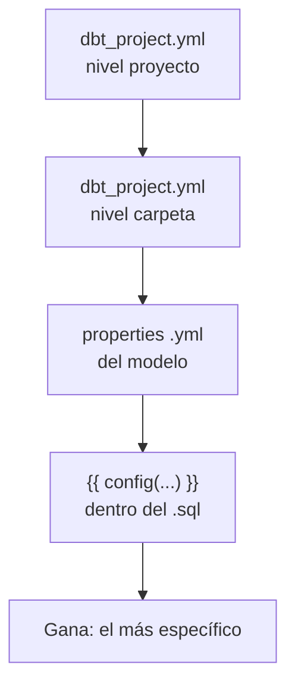

# 02 — Instalación, Proyecto y profiles.yml

## Instalación

Desde dbt 1.8, se instala **`dbt-core` + el adapter** de tu warehouse. Siempre en un entorno virtual (ver `Python/22 - Virtual Environments.md`).

```bash
# Con pip
python -m venv .venv
source .venv/bin/activate          # Windows: .venv\Scripts\activate
pip install dbt-core dbt-duckdb

# Con uv (más rápido, recomendado)
uv init ecommerce-dbt && cd ecommerce-dbt
uv add dbt-core dbt-duckdb
uv run dbt --version
```

Salida esperada de `dbt --version`:

```text
Core:
  - installed: 1.10.x
  - latest:    1.10.x - Up to date!

Plugins:
  - duckdb: 1.9.x - Up to date!
```

> **Fija versiones.** En un `requirements.txt` o `pyproject.toml` usa rangos como `dbt-core>=1.10,<1.11`. Las versiones menores de dbt pueden introducir deprecaciones; actualizar debe ser una decisión deliberada, no un accidente del CI.

### dbt Fusion (opcional)

El motor Fusion se instala como binario independiente, no con pip:

```bash
curl -fsSL https://public.cdn.getdbt.com/fs/install/install.sh | sh -s -- --update
dbtf --version     # el binario suele exponerse como `dbtf` o `dbt`
```

La extensión oficial de **dbt para VS Code** usa Fusion para autocompletado, lineage en el editor y detección de errores de SQL antes de ejecutar.

## Crear un proyecto

```bash
dbt init ecommerce
```

`dbt init` pregunta qué adapter usar y genera la estructura:

```text
ecommerce/
├── dbt_project.yml        # configuración del proyecto
├── models/
│   └── example/           # bórralo: es solo un demo
├── seeds/                 # CSVs
├── snapshots/
├── macros/
├── tests/                 # singular tests
├── analyses/              # SQL que se compila pero no se materializa
└── README.md
```

Además crea (o actualiza) `~/.dbt/profiles.yml` con las credenciales.

> Si ya tienes un proyecto clonado de Git, **no** corras `dbt init`; solo necesitas configurar el perfil y ejecutar `dbt deps`.

## dbt_project.yml — anatomía completa

```yaml
# dbt_project.yml
name: 'ecommerce'               # nombre del proyecto (snake_case)
version: '1.0.0'
config-version: 2
profile: 'ecommerce'            # debe coincidir con una clave de profiles.yml

# Rutas (estos son los defaults)
model-paths: ["models"]
seed-paths: ["seeds"]
snapshot-paths: ["snapshots"]
macro-paths: ["macros"]
test-paths: ["tests"]
analysis-paths: ["analyses"]
target-path: "target"           # artefactos compilados
clean-targets: ["target", "dbt_packages"]

require-dbt-version: [">=1.8.0", "<2.0.0"]

# Variables globales (ver 09 - Jinja y Macros)
vars:
  start_date: '2024-01-01'
  currency: 'USD'

# Configuración jerárquica por carpeta
models:
  ecommerce:
    +materialized: view          # default para todo el proyecto
    staging:
      +materialized: view
      +schema: staging
      +tags: ['staging']
    intermediate:
      +materialized: ephemeral
    marts:
      +materialized: table
      +schema: marts
      finance:
        +tags: ['finance', 'daily']

seeds:
  ecommerce:
    +schema: seeds

snapshots:
  ecommerce:
    +target_schema: snapshots

data_tests:
  +severity: error              # default: los tests fallan el build

# Hooks globales (ver 09)
on-run-end:
  - "{{ log('Ejecución terminada', info=true) }}"
```

### La jerarquía de configuración

El prefijo `+` indica que es una config (no una subcarpeta). Las configs se heredan de arriba hacia abajo, y **la más específica gana**:



```sql
-- models/marts/fct_orders.sql
{{ config(materialized='incremental', unique_key='order_id') }}
select ...
```

```yaml
# models/marts/_marts.yml
models:
  - name: fct_orders
    config:
      materialized: table
      tags: ['core']
```

Si ambos existen, gana el `config()` dentro del `.sql`.

## profiles.yml — conexiones y entornos

El `profiles.yml` vive por defecto en `~/.dbt/profiles.yml` (**fuera** del repo, porque tiene credenciales). Cada **profile** tiene varios **targets** (entornos).

### DuckDB (entorno de práctica)

```yaml
# ~/.dbt/profiles.yml
ecommerce:
  target: dev                    # target por defecto
  outputs:
    dev:
      type: duckdb
      path: dev.duckdb           # archivo local de la base
      schema: main
      threads: 4
      extensions:
        - httpfs                 # leer Parquet/CSV desde S3/HTTP
        - parquet
    prod:
      type: duckdb
      path: prod.duckdb
      schema: main
      threads: 8
```

### Snowflake

```yaml
ecommerce:
  target: dev
  outputs:
    dev:
      type: snowflake
      account: xy12345.us-east-1
      user: "{{ env_var('SNOWFLAKE_USER') }}"
      password: "{{ env_var('SNOWFLAKE_PASSWORD') }}"   # o authenticator: externalbrowser
      role: TRANSFORMER
      warehouse: TRANSFORMING_WH
      database: ANALYTICS_DEV
      schema: dbt_dmendez        # esquema personal en dev
      threads: 8
    prod:
      type: snowflake
      account: xy12345.us-east-1
      user: "{{ env_var('SNOWFLAKE_USER') }}"
      private_key_path: /secrets/rsa_key.p8   # key-pair auth en prod
      role: TRANSFORMER
      warehouse: TRANSFORMING_WH
      database: ANALYTICS
      schema: analytics
      threads: 16
```

### BigQuery

```yaml
ecommerce:
  target: dev
  outputs:
    dev:
      type: bigquery
      method: oauth              # usa `gcloud auth application-default login`
      project: mi-proyecto-gcp
      dataset: dbt_dmendez       # en BigQuery "schema" = "dataset"
      location: US
      threads: 8
    prod:
      type: bigquery
      method: service-account
      keyfile: /secrets/sa.json
      project: mi-proyecto-gcp
      dataset: analytics
      threads: 16
```

### Buenas prácticas con perfiles

- **Nunca** pongas contraseñas literales: usa `{{ env_var('NOMBRE') }}`, y `{{ env_var('X', 'default') }}` para defaults.
- En dev, cada desarrollador usa un **esquema personal** (`dbt_<nombre>`) para no pisarse.
- Puedes guardar un `profiles.yml` **dentro del repo** si solo usa `env_var()` (sin secretos); dbt lo busca primero en el directorio actual. También puedes apuntar con `--profiles-dir` o la variable `DBT_PROFILES_DIR`.
- Cambia de entorno con `--target`:

```bash
dbt run --target prod
```

## dbt debug — verificar todo

```bash
dbt debug
```

```text
Configuration:
  profiles.yml file [OK found and valid]
  dbt_project.yml file [OK found and valid]
Required dependencies:
 - git [OK found]
Connection:
  type: duckdb
  path: dev.duckdb
  Connection test: [OK connection ok]
All checks passed!
```

Si falla, revisa en este orden: (1) el `profile:` de `dbt_project.yml` coincide con la clave de `profiles.yml`, (2) las variables de entorno están definidas, (3) el adapter está instalado en el mismo entorno virtual.

## Cargar datos de práctica en DuckDB

Para practicar con el proyecto de ejemplo, crea las tablas crudas una sola vez:

```python
# scripts/load_raw.py
import duckdb

con = duckdb.connect("dev.duckdb")
con.execute("create schema if not exists raw")
con.execute("""
    create or replace table raw.customers as
    select * from read_csv_auto('data/customers.csv')
""")
con.execute("""
    create or replace table raw.orders as
    select * from read_csv_auto('data/orders.csv')
""")
con.execute("""
    create or replace table raw.payments as
    select * from read_parquet('data/payments.parquet')
""")
print(con.execute("select count(*) from raw.orders").fetchone())
```

> Alternativa sin script: `dbt-duckdb` permite declarar sources que apuntan directamente a archivos externos (`external_location`), ver [[05 - Sources y Seeds]].

## .gitignore recomendado

```text
target/
dbt_packages/
logs/
*.duckdb
*.duckdb.wal
.user.yml
.venv/
```

## Estructura del repo al final de la configuración

```text
ecommerce-dbt/
├── pyproject.toml
├── dbt_project.yml
├── packages.yml
├── profiles.yml            # opcional, solo con env_var()
├── models/
│   ├── staging/
│   ├── intermediate/
│   └── marts/
├── seeds/
├── snapshots/
├── macros/
├── tests/
└── scripts/load_raw.py
```

La organización detallada de `models/` se cubre en [[13 - Estructura de Proyecto y Modelado]].

## Ver también

- [[dbt/01 - Introducción y Arquitectura|01 - Introducción y Arquitectura]]
- [[03 - CLI y Selección de Nodos]]
- [[13 - Estructura de Proyecto y Modelado]]
- [[24-Configuracion-Profesional-de-Proyectos]] (en `Machine Learning/`) — manejo de configuración y secretos
- [[12-Gestion-Moderna-de-Proyectos-Python]] (en `Machine Learning/`) — uv y entornos
- [[DuckDB/01 - Introducción y Arquitectura|DuckDB]]: cheat-sheet del motor; opciones avanzadas de dbt-duckdb en [[DuckDB/16 - DuckDB en Pipelines y Buenas Prácticas#dbt-duckdb|DuckDB/16]]
