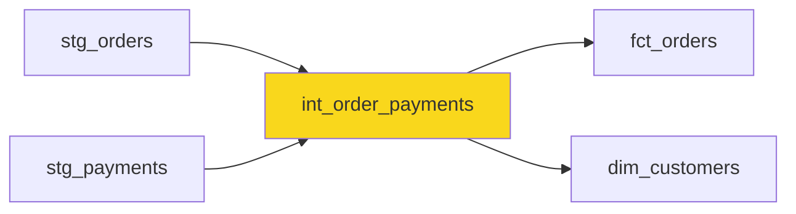

# 03 — CLI y Selección de Nodos

## Comandos principales

| Comando | Qué hace |
|---|---|
| `dbt debug` | Verifica configuración y conexión |
| `dbt deps` | Instala los packages de `packages.yml` en `dbt_packages/` |
| `dbt parse` | Parsea el proyecto y escribe `manifest.json` (útil para validar sintaxis rápido) |
| `dbt compile` | Renderiza Jinja a SQL en `target/compiled/` sin ejecutar nada |
| `dbt run` | Materializa models (no ejecuta tests) |
| `dbt test` | Ejecuta data tests y unit tests |
| `dbt seed` | Carga los CSV de `seeds/` |
| `dbt snapshot` | Ejecuta snapshots |
| `dbt build` | **run + test + seed + snapshot** en orden del DAG; si un test falla, salta lo que está río abajo |
| `dbt show` | Ejecuta un modelo o query y muestra filas en la terminal (sin materializar) |
| `dbt ls` (`list`) | Lista los nodos que coinciden con una selección |
| `dbt source freshness` | Comprueba la frescura de los sources |
| `dbt docs generate` / `dbt docs serve` | Genera y sirve el sitio de documentación |
| `dbt run-operation <macro>` | Ejecuta una macro suelta (mantenimiento, grants, etc.) |
| `dbt retry` | Re-ejecuta solo los nodos que fallaron o fueron saltados en la última ejecución |
| `dbt clone` | Clona (zero-copy cuando el warehouse lo soporta) modelos desde otro estado/entorno |
| `dbt clean` | Borra `target/` y `dbt_packages/` |
| `dbt init` | Crea un proyecto nuevo |

### `build` vs. `run` + `test`

```bash
# Antiguo patrón: construye TODO y luego testea TODO
dbt run && dbt test

# Patrón recomendado: cada modelo se testea justo después de construirse
dbt build
```

Con `build`, si `stg_orders` falla su test `unique`, `fct_orders` **no se construye** con datos malos — queda como `SKIP`. Con `run && test` ya se habría construido.

### Flags globales útiles

```bash
dbt build --target prod              # usar otro target
dbt build --threads 16               # sobreescribir paralelismo
dbt build --full-refresh             # reconstruir incrementales y seeds desde cero
dbt build --fail-fast                # (-x) detenerse al primer error
dbt build --vars '{"start_date": "2025-01-01"}'
dbt build --empty                    # ejecuta con LIMIT 0: valida SQL/esquemas sin procesar datos
dbt run --debug                      # logs detallados (SQL ejecutado, timings)
dbt compile --select fct_orders --quiet --output json
dbt --log-format json build          # logs estructurados para observabilidad
```

### `dbt show` para explorar

```bash
dbt show --select stg_orders --limit 10
dbt show --inline "select status, count(*) from {{ ref('stg_orders') }} group by 1"
```

Es el equivalente a hacer un `df.head()` mientras desarrollas.

## Sintaxis de selección de nodos

Casi todos los comandos aceptan `--select` (`-s`) y `--exclude`. Dominarlos es lo que separa usar dbt de usarlo bien.

### Por nombre y por grafo

```bash
dbt build -s fct_orders            # solo ese modelo
dbt build -s +fct_orders           # el modelo y TODOS sus ancestros (upstream)
dbt build -s fct_orders+           # el modelo y TODOS sus descendientes (downstream)
dbt build -s +fct_orders+          # ancestros + modelo + descendientes
dbt build -s 1+fct_orders          # solo padres directos (1 nivel)
dbt build -s fct_orders+2          # hasta 2 niveles hacia abajo
dbt build -s @stg_orders           # descendientes + todos los ancestros de esos descendientes
```

`@` es útil en CI: asegura que todo lo que un descendiente necesita también exista.



Para `-s int_order_payments`:

| Selector | Nodos |
|---|---|
| `int_order_payments` | int_order_payments |
| `+int_order_payments` | stg_orders, stg_payments, int_order_payments |
| `int_order_payments+` | int_order_payments, fct_orders, dim_customers |
| `+int_order_payments+` | los cinco |

### Métodos de selección

```bash
dbt build -s tag:finance                    # por tag
dbt build -s path:models/marts              # por carpeta
dbt build -s models/marts/finance           # (path: es implícito si parece ruta)
dbt build -s config.materialized:incremental
dbt build -s resource_type:snapshot
dbt build -s source:raw+                    # todo lo que depende de cualquier source "raw"
dbt build -s source:raw.orders+             # todo lo que depende de esa tabla cruda
dbt test  -s test_type:unit                 # solo unit tests
dbt test  -s test_type:data
dbt build -s package:dbt_utils
dbt build -s exposure:dashboard_ventas+     # lo que alimenta un dashboard (con +ancestros: "+exposure:...")
dbt build -s group:finance
dbt build -s access:public
dbt build -s state:modified+ --state ./prod-artifacts   # ver más abajo
dbt build -s result:error+ --state ./target             # lo que falló la última vez
```

Los wildcards también funcionan: `-s "stg_*"`, `-s "path:models/staging/*"`.

### Unión, intersección y exclusión

```bash
# Unión (espacio): A o B
dbt build -s stg_orders stg_payments

# Intersección (coma): A y B
dbt build -s tag:finance,config.materialized:table

# Exclusión
dbt build -s +fct_orders --exclude stg_payments
dbt build --exclude tag:deprecated tag:slow
```

### Selectores con nombre (`selectors.yml`)

Cuando una selección es larga y se usa a menudo (por ejemplo en un job de producción), se nombra:

```yaml
# selectors.yml (en la raíz del proyecto)
selectors:
  - name: daily_finance
    description: "Modelos de finanzas que corren a diario"
    definition:
      union:
        - method: tag
          value: finance
        - method: tag
          value: daily
      # exclude:
      #   - method: tag
      #     value: deprecated

  - name: nightly
    default: false
    definition:
      intersection:
        - method: path
          value: models/marts
        - method: config.materialized
          value: table
```

```bash
dbt build --selector daily_finance
```

### Selección indirecta de tests

Un test que referencia dos modelos (por ejemplo, `relationships` entre `fct_orders` y `dim_customers`) ¿se ejecuta si solo seleccionas uno? Lo controla `--indirect-selection`:

| Modo | Comportamiento |
|---|---|
| `eager` (default) | Ejecuta el test si **cualquiera** de sus padres está seleccionado |
| `cautious` | Solo si **todos** sus padres están seleccionados |
| `buildable` | Si todos sus padres están seleccionados o son ancestros de lo seleccionado |
| `empty` | No ejecuta tests indirectos |

## State: comparar contra producción

dbt puede comparar el proyecto actual contra los artefactos (`manifest.json`) de otra ejecución. Es la base del **Slim CI** (ver [[15 - dbt en Producción - CI-CD y Orquestación]]).

```bash
# 1. Descargar el manifest de la última ejecución de prod a ./prod-artifacts/
# 2. Construir solo lo que cambió y sus descendientes
dbt build -s state:modified+ --state ./prod-artifacts --defer
```

| Selector de state | Qué detecta |
|---|---|
| `state:new` | Nodos que no existen en el manifest comparado |
| `state:modified` | Nuevos o con cambios (SQL, config, descripción, macros usadas...) |
| `state:modified.body` | Solo cambios en el SQL |
| `state:modified.configs` | Solo cambios de config |
| `state:modified.contract` | Cambios en el contrato del modelo |
| `state:unmodified` | Lo contrario |

`--defer` hace que, para cualquier `ref()` a un modelo **no seleccionado**, dbt use la versión de producción en lugar de exigir que exista en tu esquema de dev. Así no tienes que reconstruir todo el proyecto para probar un cambio.

## Artefactos en `target/`

| Archivo | Contenido | Usos |
|---|---|---|
| `manifest.json` | El proyecto completo parseado: nodos, configs, dependencias | Slim CI, Airflow Cosmos, herramientas de lineage |
| `run_results.json` | Resultado de cada nodo de la última ejecución (status, timing, filas) | Alertas, `dbt retry`, observabilidad |
| `catalog.json` | Columnas y tipos reales del warehouse (generado por `docs generate`) | Sitio de docs |
| `sources.json` | Resultados de `source freshness` | Alertas de datos atrasados |
| `compiled/` | SQL renderizado | Debugging: copia y pega en el warehouse |
| `run/` | SQL final con DDL | Ver exactamente qué se ejecutó |

```bash
# Ver los modelos más lentos de la última ejecución
jq -r '.results[] | [.unique_id, .execution_time] | @tsv' target/run_results.json | sort -k2 -nr | head
```

## Cheat-sheet rápido del día a día

```bash
dbt build -s +mi_modelo                # construir algo y lo que necesita
dbt build -s mi_modelo+                # ver qué rompí río abajo
dbt compile -s mi_modelo && cat target/compiled/ecommerce/models/.../mi_modelo.sql
dbt show -s mi_modelo --limit 20
dbt test -s mi_modelo
dbt retry                              # tras un fallo
dbt ls -s tag:finance --resource-type model --output name
```

## Ver también

- [[02 - Instalación, Proyecto y profiles.yml]]
- [[04 - Models, ref() y el DAG]]
- [[15 - dbt en Producción - CI-CD y Orquestación]]
- `Git/` — el flujo de ramas sobre el que se apoya el desarrollo en dbt
