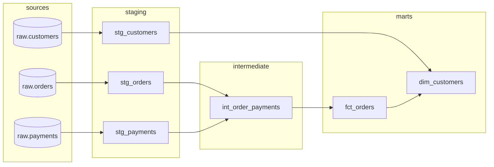

# 04 — Models, ref() y el DAG

## Qué es un model

Un **model** es un archivo `.sql` dentro de `models/` que contiene **un único `SELECT`**. El nombre del archivo (sin extensión) es el nombre del modelo y, por defecto, el nombre de la tabla/vista resultante.

```sql
-- models/staging/stg_customers.sql
select
    id                          as customer_id,
    trim(first_name)            as first_name,
    trim(last_name)             as last_name,
    lower(email)                as email,
    created_at::timestamp       as created_at
from {{ source('raw', 'customers') }}
```

Reglas clave:

- **No escribas `CREATE TABLE`, `INSERT` ni `DROP`.** dbt genera ese DDL según la materialización (ver [[06 - Materializaciones]]).
- **No termines con `;`.** dbt envuelve tu `SELECT` dentro de otra sentencia; un `;` la rompe.
- **Un modelo = una tabla/vista.** Si necesitas dos salidas, son dos archivos.
- **Los nombres de modelo deben ser únicos en todo el proyecto**, aunque estén en carpetas distintas (o usa model versions / packages, ver [[12 - Documentación, Lineage y Contratos]]).

Lo que dbt ejecuta realmente (materialización `view`, DuckDB):

```sql
create view "dev"."main_staging"."stg_customers" as (
    select
        id as customer_id,
        ...
    from "dev"."raw"."customers"
);
```

## ref(): la función más importante de dbt

`ref()` referencia otro model (o seed o snapshot) **por nombre**, nunca por nombre de tabla físico.

```sql
-- models/marts/dim_customers.sql
with customers as (
    select * from {{ ref('stg_customers') }}
),

orders as (
    select * from {{ ref('fct_orders') }}
),

customer_orders as (
    select
        customer_id,
        min(order_date)   as first_order_date,
        max(order_date)   as most_recent_order_date,
        count(*)          as number_of_orders,
        sum(total_amount) as lifetime_value
    from orders
    group by 1
)

select
    c.customer_id,
    c.first_name,
    c.last_name,
    c.email,
    co.first_order_date,
    co.most_recent_order_date,
    coalesce(co.number_of_orders, 0) as number_of_orders,
    coalesce(co.lifetime_value, 0)   as lifetime_value
from customers c
left join customer_orders co using (customer_id)
```

### Qué hace `ref()` por ti

1. **Construye el DAG.** Durante el parse, dbt registra que `dim_customers` depende de `stg_customers` y `fct_orders`. Así sabe el orden de ejecución.
2. **Resuelve el nombre físico según el entorno.** En `dev` compila a `"dev"."dbt_dmendez_staging"."stg_customers"`; en `prod`, a `"analytics"."staging"."stg_customers"`. El mismo código funciona en ambos.
3. **Habilita `--defer` y Slim CI** (ver [[03 - CLI y Selección de Nodos]], sección "State").
4. **Alimenta el lineage** de la documentación.

> **Regla de oro:** si escribes un nombre de tabla hardcodeado (`from analytics.stg_orders`) en lugar de `ref()`, dbt no sabe que existe la dependencia. El modelo puede ejecutarse antes que su padre y leer datos viejos, y el lineage queda roto.

### Variantes de ref()

```sql
{{ ref('stg_orders') }}                    -- modelo del propio proyecto
{{ ref('dbt_utils', 'some_model') }}       -- modelo de un package (2 argumentos)
{{ ref('dim_customers', v=2) }}            -- versión específica de un modelo versionado
{{ ref('finance_project', 'fct_revenue') }} -- cross-project ref (dbt Mesh)
```

### Dependencias ocultas: `-- depends_on:`

Si un `ref()` solo aparece dentro de un bloque condicional que no se ejecuta durante el parse, dbt no lo detecta. Fuerza la dependencia con un comentario:

```sql
-- depends_on: {{ ref('stg_orders') }}

  ...

```

## El DAG

El **DAG (Directed Acyclic Graph)** es el grafo de todos los nodos y sus dependencias. "Acíclico" significa que no puede haber ciclos: si `A` usa `B` y `B` usa `A`, dbt falla con `Found a cycle`.



### Ejecución y paralelismo

dbt ordena los nodos topológicamente y ejecuta en paralelo todo lo que no tiene dependencias pendientes, hasta `threads` a la vez:

| Ola | Nodos ejecutados en paralelo |
|---|---|
| 1 | stg_customers, stg_orders, stg_payments |
| 2 | int_order_payments (si no es ephemeral) |
| 3 | fct_orders |
| 4 | dim_customers |

Salida típica de `dbt run`:

```text
1 of 6 START sql view model main_staging.stg_customers ........ [RUN]
2 of 6 START sql view model main_staging.stg_orders ........... [RUN]
3 of 6 START sql view model main_staging.stg_payments ......... [RUN]
1 of 6 OK created sql view model main_staging.stg_customers ... [OK in 0.08s]
...
6 of 6 OK created sql table model main_marts.dim_customers .... [OK in 0.21s]

Done. PASS=6 WARN=0 ERROR=0 SKIP=0 TOTAL=6
```

Si un modelo falla, sus descendientes quedan como `SKIP`; los modelos de otras ramas del DAG siguen ejecutándose.

## Estilo de escritura: CTEs de importación

La convención de dbt Labs es estructurar cada modelo con **CTEs**: primero las "importaciones" (`select * from ref(...)`), luego CTEs lógicas, y al final un `select` limpio.

```sql
-- models/intermediate/int_order_payments.sql
with

orders as (
    select * from {{ ref('stg_orders') }}
),

payments as (
    select * from {{ ref('stg_payments') }}
    where status = 'success'
),

payments_per_order as (
    select
        order_id,
        sum(case when payment_method = 'credit_card' then amount else 0 end) as credit_card_amount,
        sum(case when payment_method = 'coupon'      then amount else 0 end) as coupon_amount,
        sum(amount) as total_amount
    from payments
    group by 1
),

final as (
    select
        orders.order_id,
        orders.customer_id,
        orders.order_date,
        orders.status,
        coalesce(p.credit_card_amount, 0) as credit_card_amount,
        coalesce(p.coupon_amount, 0)      as coupon_amount,
        coalesce(p.total_amount, 0)       as total_amount
    from orders
    left join payments_per_order p using (order_id)
)

select * from final
```

Ventajas: cada CTE es fácil de leer y depurar (puedes cambiar el `select * from final` por `select * from payments_per_order` mientras desarrollas), y las importaciones al inicio muestran de un vistazo de qué depende el modelo. Los warehouses modernos optimizan las CTEs igual que subqueries, así que no hay penalización. Para el SQL de fondo, ver [[Common Table Expressions]] y [[Window Functions]] en `SQL/`.

## Nombre, esquema y alias

Por defecto: **tabla = nombre del archivo**, **esquema = el del target**. Se cambia con configs:

```sql
{{ config(
    alias='orders',          -- nombre físico: "orders" en vez de "fct_orders"
    schema='finance',        -- esquema personalizado
    database='analytics_db'  -- base de datos (si el warehouse lo soporta)
) }}
```

### El comportamiento de `schema` que sorprende a todos

Con `target.schema = dbt_dmendez` y `+schema: marts`, dbt crea **`dbt_dmendez_marts`**, no `marts`. Es intencional: en dev cada persona tiene sus propios esquemas y no pisa a nadie. El responsable es la macro `generate_schema_name`:

```sql
-- comportamiento por defecto (simplificado)

    
        {{ target.schema }}
    
        {{ target.schema }}_{{ custom_schema_name | trim }}
    

```

Patrón muy común: en **prod** usar el esquema "limpio" y en **dev** mantener el prefijo personal. Se sobreescribe creando la macro en `macros/`:

```sql
-- macros/generate_schema_name.sql

    
        {{ custom_schema_name | trim }}
    
        {{ target.schema }}
    
        {{ target.schema }}_{{ custom_schema_name | trim }}
    

```

| Target | `+schema` | Esquema resultante |
|---|---|---|
| dev (`dbt_dmendez`) | `marts` | `dbt_dmendez_marts` |
| prod (`analytics`) | `marts` | `marts` |
| cualquiera | (ninguno) | el del target |

## Properties: el YAML del modelo

Cada modelo puede (y debe) tener propiedades en un `.yml` dentro de su carpeta. Convención: un archivo por carpeta, con prefijo `_` para que aparezca primero (`_staging__models.yml`).

```yaml
# models/marts/_marts__models.yml
version: 2

models:
  - name: fct_orders
    description: "Una fila por orden, con montos pagados por método de pago."
    config:
      materialized: table
      tags: ['finance']
    columns:
      - name: order_id
        description: "Clave primaria."
        data_tests:
          - unique
          - not_null
      - name: customer_id
        data_tests:
          - relationships:
              to: ref('dim_customers')
              field: customer_id
      - name: total_amount
        description: "Monto total pagado (USD)."
```

Los tests se profundizan en [[11 - Tests de Datos y Unit Tests]] y la documentación en [[12 - Documentación, Lineage y Contratos]].

## Analyses

La carpeta `analyses/` contiene SQL que usa `ref()` y Jinja pero **no se materializa**: dbt solo lo compila. Útil para queries ad hoc versionadas o para reportes que alguien copiará al warehouse.

```bash
dbt compile -s analyses/ingresos_por_mes.sql
# SQL listo en target/compiled/ecommerce/analyses/ingresos_por_mes.sql
```

## Deshabilitar un modelo

```sql
{{ config(enabled=false) }}
```

O en `dbt_project.yml`: `+enabled: false` para una carpeta entera. Los modelos deshabilitados no se parsean como parte del DAG (y cualquier `ref()` a ellos falla).

## Ver también

- [[03 - CLI y Selección de Nodos]]
- [[05 - Sources y Seeds]]
- [[06 - Materializaciones]]
- [[13 - Estructura de Proyecto y Modelado]]
- [[Common Table Expressions]] y [[Views]] (en `SQL/`)
- [[26-SQL-Profesional-Nivel-1-Consultas-Avanzadas]] (en `Machine Learning/`)
