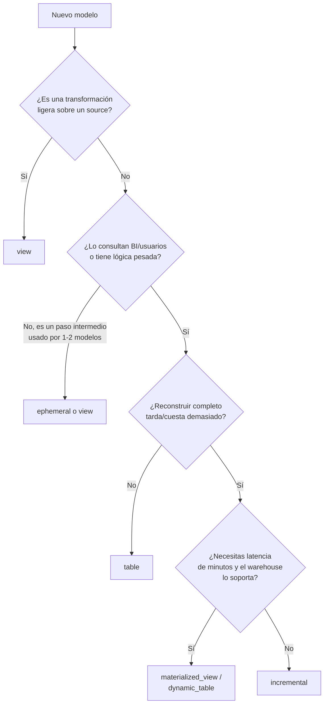

# 06 — Materializaciones

Una **materialización** es la estrategia con la que dbt persiste un modelo en el warehouse. Tú escribes el mismo `SELECT`; la materialización decide qué DDL lo envuelve.

## Las cinco materializaciones nativas

| Materialización | Qué crea | Se recalcula | Costo de construir | Costo de consultar |
|---|---|---|---|---|
| `view` | Una vista | Cada vez que alguien la consulta | Casi cero | Alto (ejecuta toda la lógica) |
| `table` | Una tabla física | Cada `dbt run` (drop + create) | Alto | Bajo |
| `incremental` | Una tabla física | Solo filas nuevas/cambiadas en cada run | Bajo (tras el primer run) | Bajo |
| `ephemeral` | Nada: se inyecta como CTE en quien lo usa | En cada modelo que lo referencia | Cero | Depende del padre |
| `materialized_view` | Una vista materializada del warehouse | El warehouse la refresca | Medio | Bajo |

### view

```sql
{{ config(materialized='view') }}
select ... from {{ source('raw', 'orders') }}
```

```sql
-- DDL generado
create or replace view "dev"."main_staging"."stg_orders" as (select ...);
```

- **Úsala para:** staging (transformaciones ligeras: renombres, casts), modelos poco consultados.
- **Ventaja:** siempre muestra datos actuales, no ocupa almacenamiento.
- **Problema:** si apilas muchas vistas, cada consulta del dashboard re-ejecuta toda la cadena.

### table

```sql
{{ config(materialized='table') }}
```

```sql
-- DDL generado (simplificado): construye en una tabla temporal y hace swap
create table "dev"."main_marts"."fct_orders__dbt_tmp" as (select ...);
alter table "dev"."main_marts"."fct_orders" rename to "fct_orders__dbt_backup";
alter table "dev"."main_marts"."fct_orders__dbt_tmp" rename to "fct_orders";
drop table "dev"."main_marts"."fct_orders__dbt_backup";
```

El swap hace que los consumidores nunca vean una tabla a medio construir.

- **Úsala para:** marts consumidos por BI, modelos con lógica pesada, cualquier cosa consultada a menudo.
- **Problema:** reconstruye todo cada vez. Con cientos de millones de filas, pasa a `incremental`.

### incremental

Inserta o actualiza solo lo nuevo. Tiene su propio archivo: [[07 - Modelos Incrementales]].

### ephemeral

```sql
-- models/intermediate/int_order_payments.sql
{{ config(materialized='ephemeral') }}
select ...
```

No crea nada en el warehouse. Cuando `fct_orders` hace `ref('int_order_payments')`, dbt **inyecta su SQL como CTE**:

```sql
-- fct_orders compilado
with __dbt__cte__int_order_payments as (
    select ...   -- el SQL del modelo ephemeral
)
select * from __dbt__cte__int_order_payments
```

- **Úsala para:** lógica intermedia pequeña, reutilizada por pocos modelos, que no tiene sentido exponer.
- **Problemas:** no puedes consultarla directamente para depurar (`dbt show` sí funciona), no se puede testear con data tests a nivel de tabla, y si muchos modelos la usan, el cálculo se repite en cada uno. Con abuso, el SQL compilado se vuelve ilegible.

### materialized_view

```sql
{{ config(
    materialized='materialized_view',
    on_configuration_change='apply'     # apply | continue | fail
) }}
```

Delega el refresco al warehouse (Snowflake las llama **dynamic tables**, con su propia materialización `dynamic_table` en `dbt-snowflake`; BigQuery, Postgres, Redshift y Databricks tienen materialized views). Útil para casi-tiempo-real sin programar `dbt run` cada pocos minutos. El soporte y las restricciones (no todos los SQL son válidos) varían mucho por warehouse.

## Árbol de decisión



**Regla práctica de dbt Labs:** empieza con `view`; cuando tarde en consultarse, pasa a `table`; cuando tarde en construirse, pasa a `incremental`. No optimices antes de tiempo.

## Dónde configurarla

```yaml
# dbt_project.yml — por carpetas (lo más común)
models:
  ecommerce:
    staging:
      +materialized: view
    intermediate:
      +materialized: ephemeral
    marts:
      +materialized: table
```

```sql
-- excepción puntual dentro del modelo
{{ config(materialized='incremental', unique_key='event_id') }}
```

## Configuraciones específicas por warehouse

Cada adapter añade configs propias que van en el mismo `config()`:

```sql
-- Snowflake
{{ config(
    materialized='table',
    cluster_by=['order_date'],
    transient=true,              # sin Fail-safe: más barato para tablas reconstruibles
    snowflake_warehouse='TRANSFORMING_XL'   # warehouse más grande solo para este modelo
) }}

-- BigQuery
{{ config(
    materialized='table',
    partition_by={'field': 'order_date', 'data_type': 'date', 'granularity': 'day'},
    cluster_by=['customer_id', 'status'],
    require_partition_filter=true
) }}

-- Databricks
{{ config(
    materialized='table',
    file_format='delta',
    partition_by=['order_date'],
    liquid_clustered_by=['customer_id']
) }}

-- Postgres
{{ config(
    materialized='table',
    indexes=[
      {'columns': ['order_id'], 'unique': True},
      {'columns': ['customer_id', 'order_date']}
    ]
) }}
```

Particionar y clusterizar marts grandes por la columna de fecha que filtran los dashboards puede reducir el costo de consulta en órdenes de magnitud — es la versión dbt de lo visto en [[27-SQL-Profesional-Nivel-2-Optimizacion]].

## Materialización `external` en dbt-duckdb

Escribe el resultado como archivo en lugar de tabla:

```sql
{{ config(
    materialized='external',
    location='output/fct_orders.parquet',
    format='parquet'
) }}
select * from {{ ref('int_order_payments') }}
```

Así puedes producir Parquet limpios que luego lee Pandas/Polars, un modelo de ML o Power BI — sin warehouse en la nube.

## Otras configs que afectan la persistencia

| Config | Efecto |
|---|---|
| `persist_docs: {relation: true, columns: true}` | Escribe las descripciones del YAML como comentarios en el warehouse (visible desde Snowflake/BigQuery UI) |
| `grants: {select: ['reporter', 'bi_role']}` | Aplica `GRANT SELECT` tras cada build (ver [[DCL (Data Control Language)]] en `SQL/`) |
| `full_refresh: false` | Impide que `--full-refresh` reconstruya este modelo (protege incrementales enormes) |
| `docs: {show: false}` | Oculta el nodo en el sitio de docs |
| `query_tag` (Snowflake) / `labels` (BigQuery) | Etiqueta las queries para atribuir costos |

## Materializaciones personalizadas

Las materializaciones son macros Jinja (``). Se pueden escribir propias o instalarlas de packages, pero es un tema avanzado y raramente necesario: casi todos los casos se cubren con las nativas + configs del adapter.

## Ver también

- [[07 - Modelos Incrementales]]
- [[04 - Models, ref() y el DAG]]
- [[16 - Python Models, Ecosistema y Buenas Prácticas]] — performance
- [[Views]] (en `SQL/`)
- [[27-SQL-Profesional-Nivel-2-Optimizacion]] (en `Machine Learning/`)
