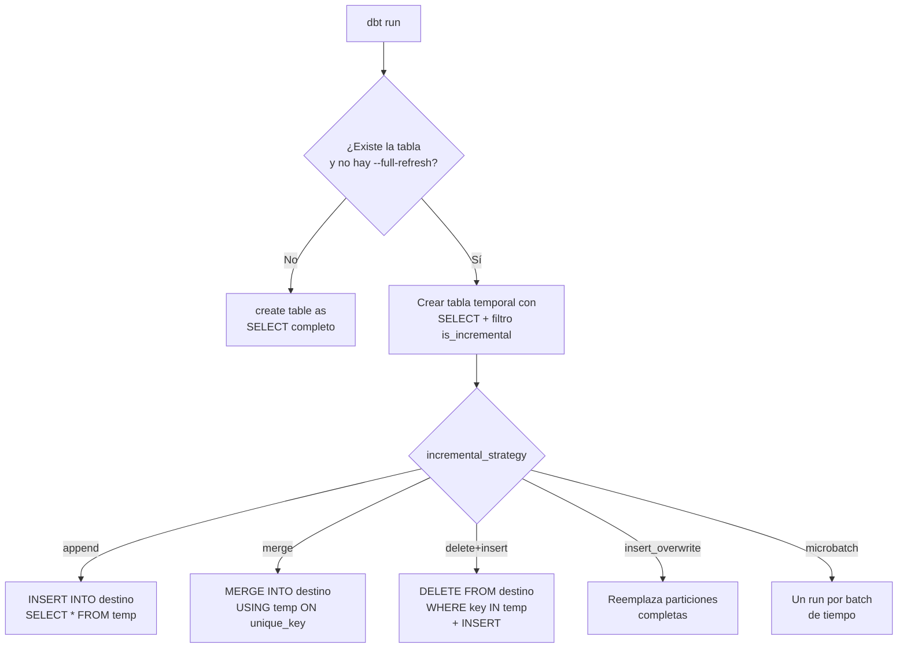

# 07 — Modelos Incrementales

> Complementa [[44-Ingesta-Incremental-CDC-e-Idempotencia]] en `Machine Learning/`, que explica la teoría de cargas incrementales, CDC e idempotencia. Aquí se ve cómo dbt la implementa en la capa de transformación.

## El problema

Una tabla de eventos con 2.000 millones de filas, que crece 5 millones por día. Como `table`, cada `dbt run` reprocesa los 2.000 millones. Como `incremental`, el primer run construye todo y los siguientes **solo procesan los 5 millones nuevos** y los insertan o fusionan en la tabla existente.

## Anatomía de un modelo incremental

```sql
-- models/marts/fct_events.sql
{{ config(
    materialized='incremental',
    unique_key='event_id',
    incremental_strategy='merge',
    on_schema_change='append_new_columns'
) }}

select
    event_id,
    user_id,
    event_type,
    event_timestamp,
    _loaded_at
from {{ ref('stg_events') }}


  -- solo en ejecuciones incrementales: filas posteriores a lo que ya tengo
  where _loaded_at > (select max(_loaded_at) from {{ this }})

```

### Las dos piezas clave

- **`is_incremental()`** devuelve `true` solo si: (1) el modelo es `incremental`, (2) la tabla ya existe en el warehouse, y (3) no se pasó `--full-refresh`. En el primer run devuelve `false` y se construye todo.
- **`{{ this }}`** es la relación del propio modelo (la tabla destino ya existente). Permite consultar "¿hasta dónde llegué?".

### Lo que dbt ejecuta



## Estrategias incrementales

| Estrategia | Comportamiento | Requiere `unique_key` | Ideal para | Adapters |
|---|---|---|---|---|
| `append` | Solo inserta | No | Logs/eventos inmutables, donde no hay updates | Todos |
| `merge` | Upsert: actualiza las existentes, inserta las nuevas | Sí | Tablas con updates (órdenes que cambian de estado) | Snowflake, BigQuery, Databricks, Postgres 15+, DuckDB |
| `delete+insert` | Borra las claves que llegan y las reinserta | Sí | Cuando `merge` es lento o no existe | Snowflake, Postgres, Redshift, DuckDB |
| `insert_overwrite` | Reemplaza particiones enteras | No (usa particiones) | Tablas particionadas por fecha en BigQuery/Spark | BigQuery, Spark, Databricks |
| `microbatch` | Procesa por lotes de tiempo independientes | No (usa `event_time`) | Series temporales enormes, backfills | Todos los principales (dbt 1.9+) |

> **Cuidado con `append` + filas repetidas:** si el filtro deja pasar filas que ya existían (por ejemplo, por un `>=` en vez de `>`), se duplican. `append` no es idempotente por sí solo.

### merge con unique_key

```sql
{{ config(
    materialized='incremental',
    unique_key='order_id',
    incremental_strategy='merge',
    merge_update_columns=['status', 'updated_at']   # solo actualiza estas columnas
    -- o: merge_exclude_columns=['created_at']
) }}

select * from {{ ref('stg_orders') }}

  where updated_at > (select max(updated_at) from {{ this }})

```

`unique_key` puede ser compuesta:

```sql
{{ config(unique_key=['order_id', 'line_number']) }}
```

> **El `unique_key` debe ser realmente único en el SELECT.** Si el lote nuevo trae dos filas con el mismo `order_id`, `merge` falla (Snowflake: "Duplicate row detected") o produce resultados no deterministas. Deduplica antes con `qualify row_number() over (partition by order_id order by updated_at desc) = 1`.

### insert_overwrite en BigQuery

```sql
{{ config(
    materialized='incremental',
    incremental_strategy='insert_overwrite',
    partition_by={'field': 'event_date', 'data_type': 'date'},
    partitions=['current_date()', 'date_sub(current_date(), interval 1 day)']
) }}

select ... from {{ ref('stg_events') }}

  where event_date >= date_sub(current_date(), interval 1 day)

```

Reescribe completas las particiones de hoy y ayer: idempotente y barato.

## Microbatch (dbt 1.9+)

En vez de escribir el filtro `is_incremental()` a mano, declaras la columna de tiempo y el tamaño del lote; dbt divide el trabajo en **batches independientes**, cada uno idempotente.

```sql
-- models/marts/fct_page_views.sql
{{ config(
    materialized='incremental',
    incremental_strategy='microbatch',
    event_time='viewed_at',       -- columna de tiempo de ESTE modelo
    batch_size='day',             -- hour | day | month | year
    begin='2024-01-01',           -- desde cuándo construir en el primer run
    lookback=3                    -- reprocesa los 3 días anteriores (datos tardíos)
) }}

select
    view_id,
    user_id,
    page,
    viewed_at
from {{ ref('stg_page_views') }}
-- ¡sin bloque is_incremental()! dbt filtra automáticamente
```

Para que dbt filtre el padre automáticamente, el padre también declara su `event_time`:

```yaml
models:
  - name: stg_page_views
    config:
      event_time: viewed_at
```

### Ventajas de microbatch

```bash
# Backfill de un rango concreto, por lotes
dbt run -s fct_page_views --event-time-start "2025-03-01" --event-time-end "2025-03-15"

# Si 2 de 15 batches fallan, retry solo reprocesa esos 2
dbt retry
```

| | Incremental clásico | Microbatch |
|---|---|---|
| Filtro | Lo escribes tú con `is_incremental()` | Automático por `event_time` |
| Granularidad de fallo | Todo o nada | Por batch |
| Backfills | `--full-refresh` o `vars` a mano | `--event-time-start/--event-time-end` |
| Datos tardíos | Lógica propia | `lookback` |
| Paralelismo | Una query | Batches en paralelo (si `concurrent_batches` lo permite) |

## on_schema_change

¿Qué pasa si añades una columna al SELECT de un modelo incremental ya existente?

| Valor | Comportamiento |
|---|---|
| `ignore` (default) | La columna nueva **no** se añade; las filas nuevas la pierden silenciosamente |
| `fail` | Error: obliga a decidir |
| `append_new_columns` | Añade columnas nuevas (nulas para filas históricas); no borra columnas eliminadas |
| `sync_all_columns` | Añade nuevas y elimina las que ya no están; ajusta tipos |

`append_new_columns` es un default sensato para la mayoría de proyectos. Para rellenar la columna nueva en filas históricas igual hace falta un `--full-refresh` o un backfill.

## Patrones de filtro

### Margen de seguridad para datos tardíos

```sql

  where _loaded_at > (select max(_loaded_at) from {{ this }}) - interval '3 days'

```

Reprocesa los últimos 3 días en cada run. Con `merge` y un `unique_key`, las filas repetidas se actualizan en vez de duplicarse → **idempotente**.

### Filtro parametrizable con vars

```sql

  where event_date >= {{ "'" ~ var('backfill_start') ~ "'" if var('backfill_start', none) else "(select max(event_date) from " ~ this ~ ")" }}

```

```bash
dbt run -s fct_events --vars '{"backfill_start": "2025-06-01"}'
```

### Filtro también en la tabla destino (rendimiento de merge)

```sql
{{ config(
    incremental_predicates=["DBT_INTERNAL_DEST.event_date > dateadd(day, -7, current_date)"]
) }}
```

Limita la parte del destino que el `MERGE` escanea. En tablas de miles de millones de filas, es la diferencia entre segundos y minutos.

## --full-refresh

```bash
dbt run -s fct_events --full-refresh
```

Ignora `is_incremental()` y reconstruye desde cero. Necesario cuando cambia la lógica histórica (un bug en el cálculo, una columna nueva que debe rellenarse). Para proteger tablas enormes de un `--full-refresh` accidental:

```sql
{{ config(full_refresh=false) }}
```

## Errores frecuentes

| Error | Síntoma | Solución |
|---|---|---|
| Filtro con `>=` + `append` | Filas duplicadas en cada run | Usa `>` o pasa a `merge` con `unique_key` |
| `unique_key` no único en el lote | Error de merge o filas aleatorias | Deduplica con `qualify row_number()` |
| Comparar zonas horarias distintas | Filas perdidas en el borde del día | Normaliza a UTC en staging |
| Lógica cambiada sin full-refresh | Histórico calculado con la lógica vieja | `--full-refresh` o backfill por microbatch |
| Columnas nuevas con `ignore` | Columna nunca aparece | `on_schema_change='append_new_columns'` |
| Filtrar por `created_at` en tablas con updates | Las actualizaciones no se propagan | Filtra por `updated_at` / `_loaded_at` |

## Testing de modelos incrementales

Los unit tests (ver [[11 - Tests de Datos y Unit Tests]]) pueden simular el modo incremental, definiendo el contenido actual de `this`:

```yaml
unit_tests:
  - name: test_fct_events_incremental_solo_nuevos
    model: fct_events
    overrides:
      macros:
        is_incremental: true
    given:
      - input: ref('stg_events')
        rows:
          - {event_id: 1, _loaded_at: "2025-01-01"}
          - {event_id: 2, _loaded_at: "2025-01-03"}
      - input: this
        rows:
          - {event_id: 1, _loaded_at: "2025-01-01"}
    expect:
      rows:
        - {event_id: 2, _loaded_at: "2025-01-03"}
```

## Ver también

- [[06 - Materializaciones]]
- [[08 - Snapshots y SCD Tipo 2]]
- [[11 - Tests de Datos y Unit Tests]]
- [[44-Ingesta-Incremental-CDC-e-Idempotencia]] (en `Machine Learning/`)
- [[Window Functions]] (en `SQL/`) — `row_number()` para deduplicar
