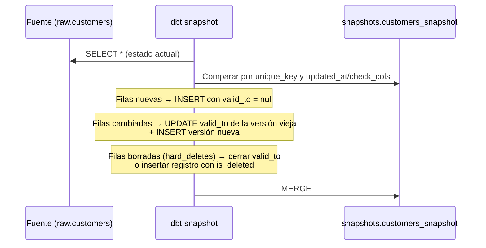

# 08 — Snapshots y SCD Tipo 2

> La teoría de Slowly Changing Dimensions (Tipos 1, 2 y 3) está en [[28-SQL-Profesional-Nivel-3-Modelado#4. Slowly Changing Dimensions (SCD) — cómo manejar cambios en las dimensiones|28-SQL-Profesional-Nivel-3-Modelado]] en `Machine Learning/`. Este archivo muestra cómo dbt implementa el **Tipo 2** automáticamente.

## El problema

La tabla `raw.customers` de la app **sobrescribe** los datos: si un cliente se muda de Lima a Arequipa, el registro viejo desaparece. Pero el análisis necesita responder "¿cuántas ventas hubo en Lima el año pasado?" con la ciudad que el cliente tenía **en ese momento**.

Un **snapshot** consulta periódicamente la tabla fuente y guarda cada versión de cada fila con su rango de vigencia.

| customer_id | city | dbt_valid_from | dbt_valid_to |
|---|---|---|---|
| 42 | Lima | 2024-01-10 | 2025-06-01 |
| 42 | Arequipa | 2025-06-01 | *null* (vigente) |

## Definición (dbt 1.9+, en YAML)

```yaml
# snapshots/customers_snapshot.yml
snapshots:
  - name: customers_snapshot
    relation: source('raw', 'customers')
    description: "Historial SCD2 de clientes."
    config:
      schema: snapshots
      unique_key: id
      strategy: timestamp
      updated_at: updated_at
      dbt_valid_to_current: "to_date('9999-12-31')"   # en vez de null para la fila vigente
      hard_deletes: invalidate                         # ignore | invalidate | new_record
```

Si necesitas transformar antes de snapshotear, apunta `relation` a un modelo ephemeral o de staging:

```yaml
    relation: ref('stg_customers_for_snapshot')
```

### Sintaxis clásica (bloque Jinja)

Muchos proyectos existentes aún la usan:

```sql
-- snapshots/customers_snapshot.sql


{{ config(
    target_schema='snapshots',
    unique_key='id',
    strategy='timestamp',
    updated_at='updated_at',
    invalidate_hard_deletes=True
) }}

select * from {{ source('raw', 'customers') }}


```

```bash
dbt snapshot
dbt snapshot -s customers_snapshot
dbt build          # también ejecuta snapshots en su lugar del DAG
```

## Estrategias de detección de cambios

### timestamp (preferida)

Usa una columna `updated_at` confiable: si cambió, hay una nueva versión.

```yaml
config:
  strategy: timestamp
  updated_at: updated_at
```

Rápida y precisa, **siempre que la fuente actualice `updated_at` en cada cambio**.

### check

Para tablas sin `updated_at` confiable: compara los valores de columnas.

```yaml
config:
  strategy: check
  check_cols: ['email', 'city', 'plan']   # o 'all'
```

Más costosa (compara columnas fila a fila) y detecta cambios solo en las columnas listadas. `check_cols: all` detecta cualquier cambio, pero también genera versiones por cambios irrelevantes.

| | timestamp | check |
|---|---|---|
| Requiere | Columna `updated_at` fiable | Nada |
| Costo | Bajo | Mayor |
| Detecta | Cualquier cambio que actualice `updated_at` | Cambios en `check_cols` |
| Riesgo | `updated_at` que no se actualiza → cambios perdidos | Versiones espurias con `all` |

## Columnas que añade dbt

| Columna | Significado |
|---|---|
| `dbt_scd_id` | Hash único de la versión (clave surrogada) |
| `dbt_updated_at` | El `updated_at` (o timestamp del snapshot) de esa versión |
| `dbt_valid_from` | Desde cuándo es válida esta versión |
| `dbt_valid_to` | Hasta cuándo; `null` (o `dbt_valid_to_current`) = vigente |
| `dbt_is_deleted` | Solo con `hard_deletes: new_record`: marca si la fila se borró en la fuente |

Los nombres se pueden personalizar con `snapshot_meta_column_names`:

```yaml
config:
  snapshot_meta_column_names:
    dbt_valid_from: valid_from
    dbt_valid_to: valid_to
    dbt_is_deleted: is_deleted
```

## Cómo funciona por dentro



El primer `dbt snapshot` copia la tabla completa con `dbt_valid_to = null`. Cada ejecución posterior aplica el diff.

## Borrados en la fuente: `hard_deletes`

| Valor | Si un `id` desaparece de la fuente... |
|---|---|
| `ignore` (default) | No pasa nada; la última versión queda "vigente" para siempre |
| `invalidate` | Se cierra su `dbt_valid_to` |
| `new_record` | Se inserta una nueva versión con `dbt_is_deleted = true` |

`new_record` es la más explícita para análisis ("el cliente se dio de baja el día X").

## Usar el snapshot en modelos

Un snapshot se referencia con `ref()`:

```sql
-- models/marts/dim_customers_history.sql
select
    {{ dbt_utils.generate_surrogate_key(['id', 'dbt_valid_from']) }} as customer_sk,
    id                as customer_id,
    city,
    plan,
    dbt_valid_from    as valid_from,
    coalesce(dbt_valid_to, '9999-12-31'::timestamp) as valid_to,
    dbt_valid_to is null as is_current
from {{ ref('customers_snapshot') }}
```

### Join "as of" con la fact

La pregunta "ventas por la ciudad del cliente **en ese momento**":

```sql
select
    d.city,
    sum(f.total_amount) as revenue
from {{ ref('fct_orders') }} f
join {{ ref('dim_customers_history') }} d
  on f.customer_id = d.customer_id
 and f.order_date >= d.valid_from
 and f.order_date <  d.valid_to
group by 1
```

Y la versión "ciudad actual":

```sql
join {{ ref('dim_customers_history') }} d
  on f.customer_id = d.customer_id and d.is_current
```

## Buenas prácticas

- **Snapshotea lo más cerca posible del source**, con poca o ninguna transformación. Si la lógica del snapshot cambia, el historial ya capturado no se puede regenerar — es la única parte de dbt que **no es reconstruible** desde cero.
- **Ejecuta los snapshots con frecuencia suficiente.** Si corre una vez al día y un valor cambia dos veces en el día, solo se ve el último. Para capturar cada cambio necesitas CDC en la ingesta (ver [[44-Ingesta-Incremental-CDC-e-Idempotencia]]).
- **Protege el esquema de snapshots:** no lo borres en limpiezas de dev; considera un esquema compartido y fijo incluso para desarrolladores.
- **`unique_key` debe ser único en la fuente.** Si no lo es, el snapshot genera versiones corruptas. Añade un test `unique` al source.
- **No uses `--full-refresh` en snapshots**: no aplica (no se reconstruyen), y es precisamente por eso que su historia es valiosa.

## Snapshot vs. incremental vs. CDC

| | Snapshot | Incremental | CDC en la ingesta |
|---|---|---|---|
| Objetivo | Historial de cambios de estado (SCD2) | Procesar eficientemente datos nuevos | Capturar cada cambio en la fuente |
| Granularidad | La frecuencia de ejecución | — | Cada transacción |
| Reconstruible | No | Sí (`--full-refresh`) | Sí, si se guarda el log |
| Uso típico | Dimensiones (clientes, productos, precios) | Facts y eventos | Bases transaccionales críticas |

## Ver también

- [[07 - Modelos Incrementales]]
- [[13 - Estructura de Proyecto y Modelado]] — dimensiones con historial en el Star Schema
- [[10 - Packages]] — `generate_surrogate_key`
- [[28-SQL-Profesional-Nivel-3-Modelado]] (en `Machine Learning/`)
- [[44-Ingesta-Incremental-CDC-e-Idempotencia]] (en `Machine Learning/`)
