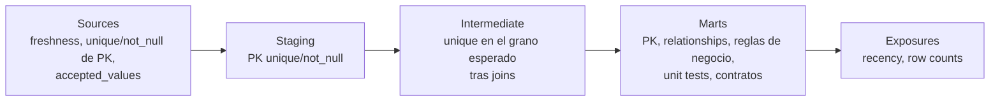

# 11 — Tests de Datos y Unit Tests

dbt tiene dos tipos de tests con propósitos distintos:

| | **Data tests** | **Unit tests** (dbt 1.8+) |
|---|---|---|
| Pregunta | "¿Los **datos** reales cumplen esta regla?" | "¿Mi **lógica SQL** produce la salida esperada para esta entrada?" |
| Corre sobre | La tabla ya construida en el warehouse | Filas de ejemplo definidas en YAML |
| Cuándo falla | Llegan datos malos (duplicados, nulos, huérfanos) | Un cambio de código rompe la lógica |
| Analogía en Python | Validación con Pandera en producción | Un test de Pytest con fixtures |
| Dónde corre idealmente | Cada build, en todos los entornos | En dev y CI (no hace falta en prod) |

## Cómo funciona un data test

Un data test es **una query que devuelve las filas que violan la regla**. Si devuelve 0 filas → `PASS`; si devuelve > 0 → `FAIL` (o `WARN`).

```sql
-- lo que dbt genera para `unique` sobre fct_orders.order_id
select order_id, count(*) as n_records
from "dev"."main_marts"."fct_orders"
where order_id is not null
group by order_id
having count(*) > 1
```

## Generic tests nativos

Los cuatro integrados, declarados en el YAML del modelo (desde 1.8 la clave es `data_tests:`; `tests:` sigue funcionando como alias):

```yaml
# models/marts/_marts__models.yml
version: 2
models:
  - name: fct_orders
    columns:
      - name: order_id
        data_tests:
          - unique
          - not_null

      - name: status
        data_tests:
          - accepted_values:
              arguments:                # dbt 1.10+: argumentos bajo `arguments`
                values: ['placed', 'shipped', 'completed', 'returned']

      - name: customer_id
        data_tests:
          - not_null
          - relationships:
              arguments:
                to: ref('dim_customers')
                field: customer_id
```

> **Nota de versión:** antes de dbt 1.10 los argumentos iban directamente bajo el nombre del test (`accepted_values: {values: [...]}`), sin `arguments:`. Esa forma sigue funcionando (con aviso de deprecación) y la verás en la mayoría de proyectos y tutoriales.

| Test | Falla cuando |
|---|---|
| `unique` | Hay valores repetidos |
| `not_null` | Hay nulos |
| `accepted_values` | Aparece un valor fuera de la lista |
| `relationships` | Hay un valor sin correspondencia en otra tabla (integridad referencial / huérfanos) |

**Mínimo recomendado:** cada modelo debe tener su clave primaria testeada con `unique` + `not_null`. Es el test con mayor retorno: detecta fan-outs de joins, que son la causa #1 de métricas infladas.

## Configuración de tests

```yaml
- name: customer_id
  data_tests:
    - relationships:
        arguments:
          to: ref('dim_customers')
          field: customer_id
        config:
          severity: warn                 # warn | error
          error_if: ">100"               # error solo si hay más de 100 filas fallidas
          warn_if: ">0"
          where: "order_date >= current_date - interval '30 days'"   # solo datos recientes
          limit: 500                     # máximo de filas a devolver
          store_failures: true           # guarda las filas fallidas en una tabla
          schema: test_failures
          tags: ['integridad']
          name: orders_customer_fk       # nombre legible del test
```

### store_failures para depurar

```bash
dbt test -s fct_orders --store-failures
```

Las filas que violan cada test quedan en una tabla (`dbt_dmendez_dbt_test__audit.unique_fct_orders_order_id`) que puedes consultar directamente para entender el problema.

### Severidad por entorno

```yaml
config:
  severity: "{{ 'error' if target.name == 'prod' else 'warn' }}"
```

## Singular tests

Un archivo `.sql` en `tests/` que devuelve las filas problemáticas. Para reglas de negocio puntuales que no vale la pena generalizar.

```sql
-- tests/assert_pagos_cuadran_con_ordenes.sql
-- El total de la orden debe coincidir con la suma de sus pagos exitosos
with orders as (
    select order_id, total_amount from {{ ref('fct_orders') }}
),
payments as (
    select order_id, sum(amount) as paid
    from {{ ref('stg_payments') }}
    where status = 'success'
    group by 1
)
select o.order_id, o.total_amount, p.paid
from orders o
join payments p using (order_id)
where abs(o.total_amount - p.paid) > 0.01
```

```sql
-- tests/assert_sin_ordenes_futuras.sql
{{ config(severity='warn') }}
select * from {{ ref('fct_orders') }}
where order_date > current_date
```

## Generic tests personalizados

Cuando una regla se repite en varios modelos, conviértela en un test genérico parametrizable:

```sql
-- tests/generic/is_positive.sql   (o macros/tests/is_positive.sql)


select {{ column_name }}
from {{ model }}
where {{ column_name }} {{ '<' if allow_zero else '<=' }} 0


```

```yaml
columns:
  - name: total_amount
    data_tests:
      - is_positive:
          arguments:
            allow_zero: true
```

Test a nivel de modelo (sin columna):

```sql
-- tests/generic/row_count_greater_than.sql

select count(*) as n
from {{ model }}
having count(*) <= {{ min_rows }}

```

```yaml
models:
  - name: fct_orders
    data_tests:
      - row_count_greater_than:
          arguments:
            min_rows: 1000
```

Antes de escribir uno propio, revisa `dbt_utils` y `dbt_expectations` (ver [[10 - Packages]]): probablemente ya existe.

## Unit tests

Introducidos en dbt 1.8. Validan la **lógica** de un modelo con entradas y salidas fijas, sin depender de los datos reales. Se escriben en YAML.

### Ejemplo: lógica de segmentación de clientes

```sql
-- models/marts/dim_customers.sql (fragmento)
select
    customer_id,
    lifetime_value,
    case
        when lifetime_value >= 1000 then 'vip'
        when lifetime_value >= 200  then 'regular'
        when lifetime_value > 0     then 'ocasional'
        else 'sin_compras'
    end as segment
from ...
```

```yaml
# models/marts/_marts__unit_tests.yml
unit_tests:
  - name: test_dim_customers_segmentacion
    description: "Valida los umbrales de segmento, incluidos los bordes."
    model: dim_customers
    given:
      - input: ref('stg_customers')
        rows:
          - {customer_id: 1}
          - {customer_id: 2}
          - {customer_id: 3}
          - {customer_id: 4}
      - input: ref('fct_orders')
        rows:
          - {customer_id: 1, total_amount: 1000}    # borde exacto → vip
          - {customer_id: 2, total_amount: 199.99}  # justo bajo regular → ocasional
          - {customer_id: 3, total_amount: 200}     # borde → regular
          # cliente 4 sin órdenes
    expect:
      rows:
        - {customer_id: 1, segment: vip}
        - {customer_id: 2, segment: ocasional}
        - {customer_id: 3, segment: regular}
        - {customer_id: 4, segment: sin_compras}
```

- **Solo declaras las columnas relevantes:** dbt rellena las demás con nulos.
- **`expect` compara solo las columnas que listas.**
- Cada `input` debe ser un `ref()` o `source()` que el modelo usa.

### Formatos de entrada

```yaml
given:
  # dict (default)
  - input: ref('stg_orders')
    rows:
      - {order_id: 1, status: completed}

  # csv inline
  - input: ref('stg_payments')
    format: csv
    rows: |
      payment_id,order_id,amount
      1,1,50
      2,1,25

  # csv desde archivo en tests/fixtures/
  - input: ref('stg_customers')
    format: csv
    fixture: customers_fixture

  # sql (para tipos complejos)
  - input: ref('stg_events')
    format: sql
    rows: |
      select 1 as event_id, cast('2025-01-01' as timestamp) as ts
```

### Overrides: macros, vars y entorno

```yaml
unit_tests:
  - name: test_filtro_dev
    model: fct_orders
    overrides:
      vars:
        start_date: '2025-01-01'
      macros:
        is_incremental: true          # simular modo incremental (ver 07)
      env_vars:
        COUNTRY: 'PE'
    given: [...]
    expect: [...]
```

### Ejecutar

```bash
dbt test -s test_type:unit
dbt test -s dim_customers,test_type:unit
dbt build --exclude-resource-type unit_test     # en prod, saltar unit tests
```

> Los unit tests necesitan que los modelos padres **existan** en el warehouse (para conocer sus tipos de columna). En CI, combina con `--empty`: `dbt run -s +dim_customers --empty` crea las tablas vacías en segundos y luego corren los unit tests.

### ¿Qué merece un unit test?

No todos los modelos. Priorízalos en:

- Lógica con **umbrales, `case when` y bordes** (como el ejemplo).
- Cálculos de fechas y ventanas (`lag`, `datediff`, fines de mes).
- **Regex** y parsing de strings.
- Lógica incremental.
- Modelos donde un bug sería caro (facturación, comisiones, métricas reportadas a directorio).
- Antes de refactorizar algo complejo (los tests garantizan que el comportamiento no cambió).

## Contratos vs. tests

Los **model contracts** (`contract: enforced: true`) garantizan el *esquema* (nombres y tipos de columnas, constraints) **antes** de construir el modelo; los tests validan el *contenido* **después**. Se complementan; ver [[12 - Documentación, Lineage y Contratos]].

## Estrategia de testing por capa



| Capa | Tests típicos |
|---|---|
| Sources | Freshness, PK `unique`+`not_null`, `accepted_values` en enums |
| Staging | PK, tipos (via contract o expectations) |
| Intermediate | Grano (`unique_combination_of_columns`) después de cada join |
| Marts | PK, `relationships`, reglas de negocio singulares, unit tests, contratos |
| Global | `dbt_project_evaluator` para cobertura de tests |

**Testea en el punto más temprano posible:** un duplicado detectado en el source es fácil de rastrear; detectado en el mart, no sabes en cuál de los 6 joins apareció.

## dbt tests vs. Pandera vs. Pytest

| | dbt data tests | Pandera | Pytest |
|---|---|---|---|
| Dónde corre | En el warehouse (SQL) | En memoria (DataFrames de Python) | En Python |
| Escala | Miles de millones de filas | Lo que quepa en memoria (o Polars/Spark) | Unidades de código |
| Ideal para | Tablas del warehouse | Features y datasets en pipelines de ML | Funciones Python, APIs |
| En tu stack | Capa de transformación | Antes de entrenar un modelo | Código de la aplicación |

Ver `Python/Pandera/` y `Python/Pytest/`.

## Ver también

- [[10 - Packages]] — dbt_utils y dbt_expectations
- [[12 - Documentación, Lineage y Contratos]]
- [[07 - Modelos Incrementales]] — unit tests de lógica incremental
- [[15 - dbt en Producción - CI-CD y Orquestación]] — tests en CI
- [[13-Testing-en-Machine-Learning]] y [[25-Testing-Avanzado]] (en `Machine Learning/`)
