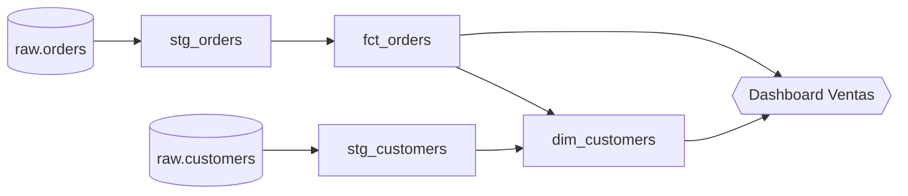

# 12 — Documentación, Lineage y Contratos

## Documentar en YAML

Toda descripción vive junto al código, en los mismos `.yml` donde están los tests. Si cambias el modelo, la documentación está a un archivo de distancia y pasa por el mismo code review.

```yaml
# models/marts/_marts__models.yml
version: 2

models:
  - name: dim_customers
    description: >
      Una fila por cliente. Incluye métricas agregadas de su historial
      de compras y su segmento comercial.
    meta:
      owner: "equipo-analytics@empresa.com"
      contains_pii: true
      sla: "diario 07:00"
    config:
      tags: ['core', 'customer']
    columns:
      - name: customer_id
        description: "Clave primaria. Proviene de `raw.customers.id`."
        data_tests: [unique, not_null]
      - name: email
        description: "Email normalizado a minúsculas."
        meta:
          pii: true
      - name: lifetime_value
        description: "{{ doc('lifetime_value') }}"
      - name: segment
        description: "{{ doc('customer_segment') }}"
```

### Doc blocks: descripciones largas y reutilizables

```markdown
<!-- models/docs/_docs.md -->

Suma de `total_amount` de todas las órdenes **completadas** del cliente, en USD.
Excluye órdenes devueltas (`status = 'returned'`).



| Segmento | Regla |
|---|---|
| `vip` | LTV ≥ 1000 |
| `regular` | 200 ≤ LTV < 1000 |
| `ocasional` | 0 < LTV < 200 |
| `sin_compras` | LTV = 0 |

```

Un mismo doc block se reutiliza en todas las columnas que significan lo mismo (`customer_id` en 15 modelos → una sola definición).

### Página principal del sitio

```markdown
<!-- models/overview.md -->

# Proyecto Ecommerce
Modelos de ventas, clientes y pagos. Capas: staging → intermediate → marts.
Contacto: #analytics en Slack.

```

## Generar y servir el sitio

```bash
dbt docs generate      # crea target/manifest.json + target/catalog.json + index.html
dbt docs serve         # servidor local en http://localhost:8080
dbt docs serve --port 8001
```

`docs generate` consulta el warehouse para obtener tipos y estadísticas reales de cada columna (`catalog.json`). El sitio muestra:

- Descripción, columnas, tests y SQL (fuente y compilado) de cada modelo.
- El **lineage graph** interactivo (el DAG), filtrable con la misma sintaxis de selección de [[03 - CLI y Selección de Nodos]].



### Publicar la documentación

El sitio es estático (`index.html` + dos JSON): se puede publicar en GitHub Pages, S3 o Netlify desde el CI. En dbt Cloud se reemplaza por **dbt Explorer** (catálogo con lineage a nivel de columna, uso, rendimiento).

`persist_docs` (ver [[06 - Materializaciones]]) escribe además las descripciones como comentarios en el warehouse, de modo que quien consulte desde Snowflake o BigQuery también las ve.

## Exposures: el lineage hasta el consumidor

Una **exposure** declara un consumidor río abajo de dbt: un dashboard, un notebook, un modelo de ML, una aplicación. Cierra el lineage: "¿qué dashboards se rompen si cambio `fct_orders`?"

```yaml
# models/marts/_exposures.yml
version: 2
exposures:
  - name: dashboard_ventas
    label: "Dashboard de Ventas (Power BI)"
    type: dashboard               # dashboard | notebook | analysis | ml | application
    maturity: high                # low | medium | high
    url: https://app.powerbi.com/groups/.../reports/...
    description: "Ventas diarias por canal y segmento de cliente."
    depends_on:
      - ref('fct_orders')
      - ref('dim_customers')
    owner:
      name: Equipo Comercial
      email: comercial@empresa.com

  - name: modelo_churn
    label: "Modelo de churn (MLflow)"
    type: ml
    maturity: medium
    depends_on:
      - ref('ml_customer_features')
    owner:
      name: Equipo Data Science
```

```bash
dbt build -s +exposure:dashboard_ventas   # construir todo lo que alimenta el dashboard
dbt ls -s +exposure:modelo_churn          # ¿de qué depende el modelo de ML?
```

## Model contracts

Un **contrato** garantiza la **forma** de un modelo: nombres de columnas, tipos de datos y constraints. Si el SQL produce algo distinto, dbt **falla antes de construir** la tabla. Es la protección para modelos que otros consumen (BI, otros equipos, ML).

```yaml
models:
  - name: dim_customers
    config:
      contract:
        enforced: true
    columns:
      - name: customer_id
        data_type: integer
        constraints:
          - type: not_null
          - type: primary_key
      - name: email
        data_type: varchar
      - name: lifetime_value
        data_type: numeric(18,2)
        constraints:
          - type: check
            expression: "lifetime_value >= 0"
      - name: segment
        data_type: varchar
      - name: first_order_date
        data_type: date
```

Con el contrato:

1. Antes de ejecutar, dbt compara las columnas del SELECT con las declaradas. Columna de más, de menos o con otro tipo → error de compilación.
2. Genera el DDL con tipos explícitos y constraints (`create table (customer_id integer not null primary key, ...)`).

```text
Compilation Error in model dim_customers
  This model has an enforced contract that failed.
  | column_name    | definition_type | contract_type | mismatch_reason    |
  | lifetime_value | DOUBLE          | NUMERIC       | data type mismatch |
```

> **Ojo con los constraints:** muchos warehouses (Snowflake, BigQuery) **no aplican** `primary_key` ni `unique`: solo los registran como metadata. `not_null` sí suele aplicarse. Por eso los contratos **no reemplazan** a los tests `unique`/`not_null`.

### Contratos vs. tests

| | Contrato | Tests |
|---|---|---|
| Valida | Esquema (nombres, tipos) | Contenido (valores) |
| Momento | Antes de construir | Después de construir |
| Si falla | La tabla no se toca | La tabla ya cambió (pero con `build` se salta lo de abajo) |
| Detecta | "Alguien renombró una columna" | "Hay duplicados" |

## Gobernanza: access, groups y versions

Para proyectos grandes o multi-equipo (y la base de **dbt Mesh**):

### Groups y access

```yaml
# models/_groups.yml
groups:
  - name: finance
    owner:
      name: Equipo Finanzas
      email: finanzas@empresa.com
```

```yaml
models:
  - name: int_revenue_adjustments
    config:
      group: finance
      access: private     # solo modelos del grupo "finance" pueden hacer ref()
  - name: fct_revenue
    config:
      group: finance
      access: public      # cualquiera (incluso otros proyectos) puede hacer ref()
```

| Access | Quién puede hacer `ref()` |
|---|---|
| `private` | Solo modelos del mismo grupo |
| `protected` (default) | Cualquier modelo del mismo proyecto |
| `public` | Cualquiera, incluidos otros proyectos (cross-project ref) |

### Model versions

Cuando un modelo público necesita un **cambio que rompe** (renombrar o quitar columnas), se versiona para que los consumidores migren a su ritmo:

```yaml
models:
  - name: dim_customers
    latest_version: 2
    config:
      contract: {enforced: true}
    columns:
      - name: customer_id
        data_type: integer
      - name: full_name
        data_type: varchar
    versions:
      - v: 2                     # usa las columnas de arriba
      - v: 1
        deprecation_date: 2026-12-31
        columns:
          - include: all
            exclude: [full_name]
          - name: first_name
            data_type: varchar
          - name: last_name
            data_type: varchar
```

Archivos: `dim_customers_v1.sql`, `dim_customers_v2.sql`. Consumidores: `ref('dim_customers')` → última versión; `ref('dim_customers', v=1)` → la vieja (con aviso de deprecación).

## Checklist de documentación mínima

- [ ] Cada source y cada mart tiene `description`.
- [ ] Cada clave primaria y cada columna de negocio no obvia tiene `description`.
- [ ] Definiciones de métricas de negocio en **doc blocks** reutilizados.
- [ ] `meta.owner` en cada mart.
- [ ] Exposures para cada dashboard y modelo de ML importante.
- [ ] Contratos en los modelos públicos o consumidos por BI.
- [ ] `dbt_project_evaluator` en CI para detectar modelos sin documentar.

## Ver también

- [[11 - Tests de Datos y Unit Tests]]
- [[13 - Estructura de Proyecto y Modelado]]
- [[14 - Semantic Layer y Métricas]]
- [[33-Documentacion-Profesional]] (en `Machine Learning/`) — principios de documentación aplicados también aquí
- [[03-Arquitectura-Empresarial-de-Datos-y-ML]] (en `Machine Learning/`) — gobierno de datos y linaje
