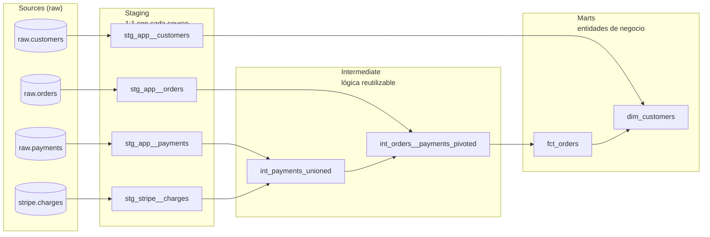
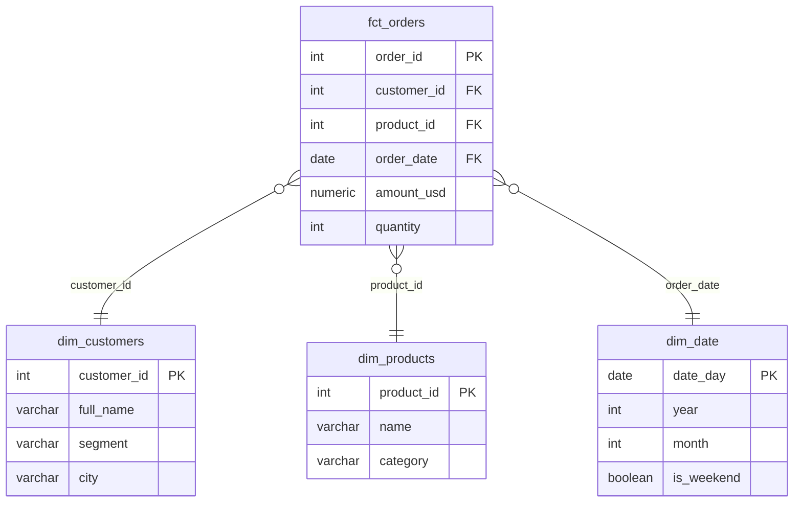

# 13 — Estructura de Proyecto y Modelado

> La teoría de modelado (normalización, Star Schema, Snowflake Schema, SCD) está en [[28-SQL-Profesional-Nivel-3-Modelado]] en `Machine Learning/`. Este archivo muestra cómo se organiza en la práctica un proyecto dbt para llegar a ese modelo.

## Las tres capas

La guía oficial de dbt Labs ("How we structure our dbt projects") organiza los modelos en capas, cada una con una responsabilidad clara:



| Capa | Responsabilidad | Materialización típica | Quién la consume |
|---|---|---|---|
| **Staging** | Limpiar y estandarizar **una** fuente: renombrar, castear, convertir unidades, recodificar. **Sin joins ni agregaciones.** | `view` | Solo otros modelos de dbt |
| **Intermediate** | Pasos lógicos intermedios: uniones de fuentes, pivots, cambios de grano, joins complejos | `ephemeral` o `view` | Solo otros modelos de dbt |
| **Marts** | Entidades de negocio listas para consumo: facts y dimensions | `table` o `incremental` | BI, analistas, ML |

### Estructura de carpetas

```text
models/
├── staging/
│   ├── app/                              # agrupado por SISTEMA FUENTE
│   │   ├── _app__sources.yml
│   │   ├── _app__models.yml
│   │   ├── stg_app__customers.sql
│   │   ├── stg_app__orders.sql
│   │   └── stg_app__payments.sql
│   └── stripe/
│       ├── _stripe__sources.yml
│       ├── _stripe__models.yml
│       └── stg_stripe__charges.sql
├── intermediate/
│   └── finance/                          # agrupado por ÁREA DE NEGOCIO
│       ├── _int_finance__models.yml
│       ├── int_payments_unioned.sql
│       └── int_orders__payments_pivoted.sql
└── marts/
    ├── finance/
    │   ├── _finance__models.yml
    │   └── fct_orders.sql
    ├── marketing/
    │   └── fct_campaign_performance.sql
    └── core/                             # entidades compartidas
        ├── _core__models.yml
        └── dim_customers.sql
```

Staging se agrupa **por fuente** (de dónde vienen los datos); intermediate y marts **por área de negocio** (quién los usa).

## Convenciones de nombres

| Patrón | Ejemplo | Significado |
|---|---|---|
| `stg_<fuente>__<entidad>` | `stg_stripe__charges` | Staging; doble guion bajo separa fuente y entidad |
| `int_<entidad>__<verbo>` | `int_orders__payments_pivoted` | Intermedio; describe la transformación |
| `fct_<proceso>` | `fct_orders`, `fct_page_views` | Fact: eventos/procesos medibles (largas, crecen) |
| `dim_<entidad>` | `dim_customers`, `dim_products` | Dimension: entidades descriptivas (anchas, cambian lento) |
| `_<carpeta>__models.yml` | `_finance__models.yml` | YAML de propiedades de la carpeta |
| `_<fuente>__sources.yml` | `_app__sources.yml` | Declaración de sources |

### Convenciones de columnas

| Convención | Ejemplo |
|---|---|
| Claves primarias: `<entidad>_id` | `customer_id`, no `id` |
| Booleanos con prefijo `is_` / `has_` | `is_active`, `has_coupon` |
| Timestamps con sufijo `_at` (UTC) | `created_at`, `shipped_at` |
| Fechas con sufijo `_date` | `order_date` |
| Montos con la unidad si no es obvia | `amount_usd`, `price_cents` |
| Todo en `snake_case` minúsculas | `first_order_date` |
| Orden: IDs → strings → numéricos → booleanos → fechas → metadata | — |

## Staging en detalle

```sql
-- models/staging/app/stg_app__orders.sql
with

source as (
    select * from {{ source('app', 'orders') }}
),

renamed as (
    select
        -- ids
        id                              as order_id,
        user_id                         as customer_id,

        -- strings
        lower(status)                   as status,

        -- numerics
        {{ cents_to_dollars('amount_cents') }} as amount_usd,

        -- booleans
        coalesce(is_gift, false)        as is_gift,

        -- timestamps
        cast(created_at as timestamp)   as created_at,
        cast(created_at as date)        as order_date,

        -- metadata
        _loaded_at

    from source
    where not coalesce(_is_test_order, false)
)

select * from renamed
```

**Sí en staging:** renombres, casts, unidades, `coalesce` de defaults, recodificar valores, filtrar registros técnicamente inválidos (órdenes de prueba), deduplicar si la fuente trae duplicados.
**No en staging:** joins, agregaciones, lógica de negocio ("¿qué es un cliente activo?").

## Marts y Star Schema

Los marts implementan el **modelo dimensional** de Kimball:



### Fact: definir el grano primero

La pregunta más importante de cualquier fact es **"¿qué representa una fila?"**. Escríbelo en la descripción y testéalo.

```yaml
models:
  - name: fct_order_lines
    description: "Grano: una fila por línea de orden (order_id + line_number)."
    data_tests:
      - dbt_utils.unique_combination_of_columns:
          combination_of_columns: [order_id, line_number]
```

### Dimensión de fechas

```sql
-- models/marts/core/dim_date.sql
with spine as (
    {{ dbt_utils.date_spine(
        datepart="day",
        start_date="cast('2020-01-01' as date)",
        end_date="cast('2030-12-31' as date)"
    ) }}
)
select
    cast(date_day as date)               as date_day,
    extract(year from date_day)          as year,
    extract(quarter from date_day)       as quarter,
    extract(month from date_day)         as month,
    strftime(date_day, '%B')             as month_name,      -- DuckDB; en Snowflake: monthname()
    extract(isodow from date_day)        as day_of_week,
    extract(isodow from date_day) in (6, 7) as is_weekend
from spine
```

Power BI y Tableau trabajan mucho mejor con una dimensión de fechas explícita (ver [[Inteligencia de Tiempo]] en `Power BI/`).

### ¿Star Schema o One Big Table (OBT)?

| | Star Schema | One Big Table (wide) |
|---|---|---|
| Estructura | Facts + dimensions separadas | Fact con todas las columnas de dimensiones ya unidas |
| Ideal para | Power BI (modelo semántico con relaciones), reutilización | Herramientas sin capa semántica, consultas ad hoc, features para ML |
| Costo | Joins al consultar | Almacenamiento y duplicación |
| Con dbt | `fct_*` + `dim_*` | Un mart adicional `obt_orders` que une ambos |

Patrón común: construir el Star Schema y, encima, OBTs específicas para quien las necesite. Power BI prefiere el star schema (ver [[Modelado de Datos]] en `Power BI/`).

## Otras carpetas del proyecto

```text
├── seeds/           # catálogos pequeños
├── snapshots/       # SCD2 (ver 08)
├── macros/
│   ├── _macros.yml
│   ├── generate_schema_name.sql
│   └── cents_to_dollars.sql
├── tests/
│   ├── generic/     # tests genéricos propios
│   └── assert_*.sql # singular tests
├── analyses/
└── models/
    └── utilities/   # dim_date, all_days, etc. (opcional)
```

## Configuración por capa en dbt_project.yml

```yaml
models:
  ecommerce:
    staging:
      +materialized: view
      +schema: staging
    intermediate:
      +materialized: ephemeral
      +schema: intermediate
    marts:
      +materialized: table
      core:
        +schema: core
      finance:
        +schema: finance
        +group: finance
      marketing:
        +schema: marketing
```

## Anti-patrones que detecta dbt_project_evaluator

| Anti-patrón | Por qué es malo |
|---|---|
| `source()` fuera de staging | Si la fuente cambia, hay que tocar muchos modelos |
| Marts que leen directo de sources | Se salta la limpieza estandarizada |
| Staging que depende de otro staging | Staging debe ser 1:1 con su fuente |
| Modelos con muchísimos hijos directos ("fan-out") | Un cambio rompe mucho; suele faltar un modelo intermedio |
| "Rejoining" de padres (A → B y A → C → B) | DAG más complejo de lo necesario |
| Joins de staging a staging en marts sin intermediate | Lógica duplicada entre marts |
| Modelos sin tests en PK / sin descripción | Calidad y documentación |
| Nombres que no siguen las convenciones | Navegación del proyecto |

```bash
dbt build -s package:dbt_project_evaluator
```

## Ver también

- [[04 - Models, ref() y el DAG]]
- [[06 - Materializaciones]]
- [[08 - Snapshots y SCD Tipo 2]]
- [[14 - Semantic Layer y Métricas]]
- [[28-SQL-Profesional-Nivel-3-Modelado]] (en `Machine Learning/`)
- [[03-Arquitectura-Empresarial-de-Datos-y-ML]] (en `Machine Learning/`) — arquitectura empresarial de datos (las capas staging/intermediate/marts equivalen aproximadamente a bronze/silver/gold de la arquitectura medallion)
- [[Modelado de Datos]] (en `Power BI/`)
