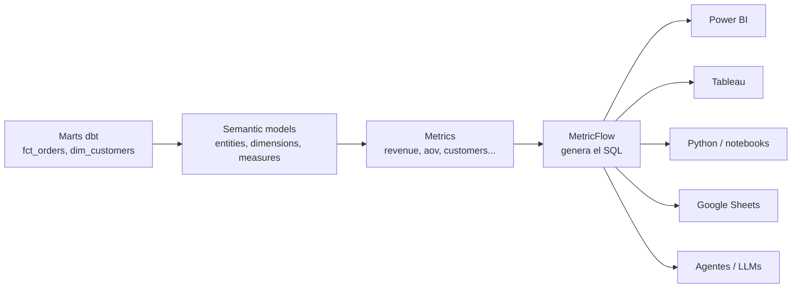

# 14 — Semantic Layer y Métricas

## El problema: "¿cuánto vendimos?" tiene cinco respuestas

En una empresa típica, el "revenue mensual" se calcula en Power BI con una medida DAX, en Tableau con un campo calculado, en un notebook de Python con Pandas y en una hoja de Excel. Cada uno filtra devoluciones, impuestos o zonas horarias de forma ligeramente distinta → cinco números distintos en la reunión de directorio.

Un **semantic layer** define cada métrica **una sola vez**, en código versionado, y todas las herramientas la consultan desde ahí. El de dbt se basa en **MetricFlow**.



> **Disponibilidad:** definir semantic models y métricas, validarlos y consultarlos localmente con MetricFlow es gratis (dbt Core). La **API del Semantic Layer** que conecta Tableau, Power BI, Sheets, etc. requiere dbt Cloud (plan Starter o superior).

## Semantic models

Un **semantic model** describe un modelo dbt (normalmente un mart) en términos semánticos: qué entidades tiene, por qué dimensiones se puede cortar y qué medidas se pueden agregar.

```yaml
# models/marts/finance/_finance__semantic.yml
semantic_models:
  - name: orders
    description: "Órdenes, una fila por orden."
    model: ref('fct_orders')
    defaults:
      agg_time_dimension: order_date

    entities:                      # las "claves" para hacer joins
      - name: order
        type: primary
        expr: order_id
      - name: customer
        type: foreign
        expr: customer_id

    dimensions:                    # por qué cortar
      - name: order_date
        type: time
        type_params:
          time_granularity: day
      - name: status
        type: categorical
      - name: is_gift
        type: categorical

    measures:                      # qué agregar
      - name: order_total
        description: "Suma de montos."
        agg: sum
        expr: total_amount
      - name: order_count
        agg: count
        expr: order_id
      - name: customers_with_orders
        agg: count_distinct
        expr: customer_id
      - name: completed_order_total
        agg: sum
        expr: "case when status = 'completed' then total_amount else 0 end"

  - name: customers
    model: ref('dim_customers')
    entities:
      - name: customer
        type: primary
        expr: customer_id
    dimensions:
      - name: segment
        type: categorical
      - name: city
        type: categorical
      - name: first_order_date
        type: time
        type_params:
          time_granularity: day
```

| Tipo de entity | Significado |
|---|---|
| `primary` | Una fila por valor, sin nulos (clave primaria) |
| `unique` | Una fila por valor, puede tener nulos |
| `foreign` | Puede repetirse (clave foránea) |
| `natural` | Clave natural, usada en SCD2 |

Como `orders` tiene la entity `customer` (foreign) y `customers` la tiene como primary, MetricFlow **sabe hacer el join solo**: puedes pedir revenue por `customer__segment` sin escribir ningún join.

Agregaciones disponibles en `agg`: `sum`, `count`, `count_distinct`, `average`, `min`, `max`, `median`, `percentile`, `sum_boolean`.

## Metrics

Las **métricas** se construyen sobre las medidas. Hay cinco tipos:

```yaml
# models/marts/finance/_finance__metrics.yml
metrics:
  # 1. simple: una medida, opcionalmente filtrada
  - name: revenue
    label: "Revenue"
    description: "Ventas de órdenes completadas (USD)."
    type: simple
    type_params:
      measure: order_total
    filter: |
      {{ Dimension('order__status') }} = 'completed'

  - name: orders
    label: "Órdenes"
    type: simple
    type_params:
      measure: order_count

  # 2. ratio: numerador / denominador
  - name: average_order_value
    label: "Ticket promedio (AOV)"
    type: ratio
    type_params:
      numerator: revenue
      denominator: orders

  # 3. derived: expresión sobre otras métricas (incluye comparaciones temporales)
  - name: revenue_growth_mom
    label: "Crecimiento de revenue MoM"
    type: derived
    type_params:
      expr: (revenue - revenue_prev_month) / nullif(revenue_prev_month, 0)
      metrics:
        - name: revenue
        - name: revenue
          offset_window: 1 month
          alias: revenue_prev_month

  # 4. cumulative: acumulado o ventana móvil
  - name: revenue_ytd
    label: "Revenue acumulado del año"
    type: cumulative
    type_params:
      measure: order_total
      cumulative_type_params:
        grain_to_date: year

  - name: active_customers_30d
    label: "Clientes activos (30 días)"
    type: cumulative
    type_params:
      measure: customers_with_orders
      cumulative_type_params:
        window: 30 days

  # 5. conversion: tasa de conversión entre dos eventos de una entidad
  - name: visit_to_purchase_rate
    type: conversion
    type_params:
      conversion_type_params:
        entity: customer
        calculation: conversion_rate
        base_measure: visits
        conversion_measure: purchases
        window: 7 days
```

La métrica `revenue_growth_mom` reemplaza lo que en DAX harías con `CALCULATE(... DATEADD(...))` (ver [[Inteligencia de Tiempo]] en `Power BI/`) — pero definido una vez para todas las herramientas.

### Time spine

MetricFlow necesita un modelo calendario para métricas acumuladas y offsets:

```sql
-- models/utilities/metricflow_time_spine.sql
{{ config(materialized='table') }}
{{ dbt_utils.date_spine(
    datepart="day",
    start_date="cast('2020-01-01' as date)",
    end_date="cast('2030-12-31' as date)"
) }}
```

```yaml
models:
  - name: metricflow_time_spine
    time_spine:
      standard_granularity_column: date_day
    columns:
      - name: date_day
        granularity: day
```

## Consultar métricas

### Localmente (dbt Core + MetricFlow)

```bash
pip install "dbt-metricflow[duckdb]"

dbt parse                                       # genera semantic_manifest.json
mf validate-configs                             # valida semantic models y métricas
mf list metrics
mf list dimensions --metrics revenue

mf query --metrics revenue,orders,average_order_value \
         --group-by metric_time__month

mf query --metrics revenue \
         --group-by metric_time__month,customer__segment \
         --where "{{ TimeDimension('metric_time', 'month') }} >= '2025-01-01'" \
         --order-by -metric_time__month

mf query --metrics revenue --group-by customer__city --explain   # muestra el SQL generado
```

`metric_time` es una dimensión especial: el `agg_time_dimension` de cada medida, en la granularidad que pidas (`__day`, `__week`, `__month`, `__quarter`, `__year`).

### En dbt Cloud

```bash
dbt sl query --metrics revenue --group-by metric_time__month
dbt sl list metrics
```

Más la API (JDBC/GraphQL) y los conectores nativos para Tableau, Power BI, Google Sheets, Excel y herramientas como Hex o Mode.

### Desde Python

```python
# Con el SDK del Semantic Layer (dbt Cloud)
from dbtsl import SemanticLayerClient

client = SemanticLayerClient(
    environment_id=123456,
    auth_token="dbtc_...",
    host="semantic-layer.cloud.getdbt.com",
)

with client.session():
    table = client.query(
        metrics=["revenue", "average_order_value"],
        group_by=["metric_time__month", "customer__segment"],
    )
    df = table.to_pandas()
```

Sin Cloud, una alternativa es correr `mf query --explain`, guardar el SQL generado y ejecutarlo con DuckDB/Pandas.

## Saved queries y exports

Consultas de métricas frecuentes con nombre propio, que además pueden materializarse como tablas:

```yaml
saved_queries:
  - name: revenue_mensual_por_segmento
    query_params:
      metrics: [revenue, orders, average_order_value]
      group_by:
        - TimeDimension('metric_time', 'month')
        - Dimension('customer__segment')
    exports:
      - name: revenue_mensual_por_segmento
        config:
          export_as: table
          schema: metrics
```

## ¿Semantic layer de dbt o medidas en el BI?

| | dbt Semantic Layer | Medidas DAX en Power BI | Campos calculados en Tableau |
|---|---|---|---|
| Fuente de verdad | Una, en Git, para todas las herramientas | Por cada modelo semántico | Por cada workbook/datasource |
| Versionado y review | Sí (YAML en Git) | Limitado (PBIP/TMDL mejora esto) | Limitado |
| Testing | Validación de configs + tests de los marts | Manual | Manual |
| Flexibilidad de análisis | Media | Muy alta (contexto de filtro) | Alta |
| Costo | Requiere dbt Cloud para la API | Incluido en Power BI | Incluido en Tableau |

En la práctica muchos equipos combinan: métricas corporativas críticas (revenue, clientes activos) en el semantic layer; análisis exploratorio en el BI. Para entender el contraste con DAX, ver [[Cálculo de Medidas y Contexto de Filtro]] en `Power BI/`.

## Ver también

- [[13 - Estructura de Proyecto y Modelado]] — los marts que alimentan el semantic layer
- [[12 - Documentación, Lineage y Contratos]]
- [[Lenguaje DAX]] e [[Inteligencia de Tiempo]] (en `Power BI/`)
- `DAX/` — la alternativa de definir medidas dentro de Power BI
