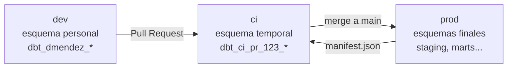

# 15 — dbt en Producción: CI/CD y Orquestación

> Complementa [[48-CICD-con-GitHub-Actions]] y [[50-Orquestacion-Prefect-y-Airflow]] en `Machine Learning/`, que explican CI/CD y orquestación en general. Aquí se aplican a un proyecto dbt.

## Entornos



| Entorno | Quién ejecuta | Datos | Objetivo |
|---|---|---|---|
| **dev** | Cada desarrollador, desde su máquina | Completos o muestra (`target.name == 'dev'` → últimos 30 días) | Iterar rápido |
| **ci** | GitHub Actions / GitLab CI en cada PR | Lo modificado + `--defer` a prod | Validar que el cambio no rompe nada |
| **prod** | Orquestador o scheduler | Completos | Producir las tablas que consume el negocio |

## Slim CI

Construir el proyecto entero en cada Pull Request es lento y caro. **Slim CI** construye solo lo que cambió y sus descendientes, usando producción para todo lo demás:

```bash
dbt build \
  --select state:modified+ \
  --defer \
  --state ./prod-artifacts \
  --target ci
```

1. `--state ./prod-artifacts` → compara contra el `manifest.json` de la última ejecución de producción.
2. `state:modified+` → selecciona los modelos cambiados y todo lo que está río abajo.
3. `--defer` → los `ref()` a modelos **no** seleccionados apuntan a las tablas de producción.

Si cambias `int_order_payments`, CI construye `int_order_payments`, `fct_orders` y `dim_customers`, leyendo `stg_orders` y `stg_payments` directamente de producción.

### Optimización: clonar en vez de construir

Para los modelos incrementales río abajo, en lugar de construirlos desde cero en CI:

```bash
dbt clone --select state:modified+,config.materialized:incremental --state ./prod-artifacts
dbt build --select state:modified+ --defer --state ./prod-artifacts
```

En Snowflake, BigQuery y Databricks `clone` es **zero-copy**: instantáneo y sin costo de almacenamiento.

## GitHub Actions

### CI en cada Pull Request

```yaml
# .github/workflows/dbt_ci.yml
name: dbt CI

on:
  pull_request:
    branches: [main]
    paths: ['models/**', 'macros/**', 'seeds/**', 'snapshots/**', 'tests/**', 'dbt_project.yml', 'packages.yml']

concurrency:
  group: dbt-ci-${{ github.event.pull_request.number }}
  cancel-in-progress: true

env:
  DBT_PROFILES_DIR: ./ci
  SNOWFLAKE_ACCOUNT: ${{ secrets.SNOWFLAKE_ACCOUNT }}
  SNOWFLAKE_USER: ${{ secrets.SNOWFLAKE_CI_USER }}
  DBT_ENV_SECRET_SNOWFLAKE_PRIVATE_KEY: ${{ secrets.SNOWFLAKE_CI_PRIVATE_KEY }}
  DBT_CI_SCHEMA: dbt_ci_pr_${{ github.event.pull_request.number }}

jobs:
  dbt-ci:
    runs-on: ubuntu-latest
    steps:
      - uses: actions/checkout@v4

      - uses: astral-sh/setup-uv@v5
        with:
          enable-cache: true

      - name: Instalar dependencias
        run: |
          uv sync --frozen
          uv run dbt deps

      - name: Descargar manifest de producción
        run: |
          mkdir -p prod-artifacts
          aws s3 cp s3://mi-bucket-dbt-artifacts/prod/manifest.json prod-artifacts/manifest.json
        env:
          AWS_ACCESS_KEY_ID: ${{ secrets.AWS_ACCESS_KEY_ID }}
          AWS_SECRET_ACCESS_KEY: ${{ secrets.AWS_SECRET_ACCESS_KEY }}

      - name: Lint SQL
        run: uv run sqlfluff lint models/ --dialect snowflake

      - name: dbt build (Slim CI)
        run: |
          uv run dbt build \
            --select state:modified+ \
            --defer --state ./prod-artifacts \
            --target ci \
            --fail-fast

      - name: Subir artefactos
        if: always()
        uses: actions/upload-artifact@v4
        with:
          name: dbt-artifacts
          path: target/*.json
```

```yaml
# ci/profiles.yml — sin secretos, solo env_var()
ecommerce:
  target: ci
  outputs:
    ci:
      type: snowflake
      account: "{{ env_var('SNOWFLAKE_ACCOUNT') }}"
      user: "{{ env_var('SNOWFLAKE_USER') }}"
      private_key: "{{ env_var('DBT_ENV_SECRET_SNOWFLAKE_PRIVATE_KEY') }}"
      role: CI_ROLE
      warehouse: CI_WH
      database: ANALYTICS_CI
      schema: "{{ env_var('DBT_CI_SCHEMA') }}"
      threads: 8
```

### Limpiar esquemas de CI al cerrar el PR

```yaml
# .github/workflows/dbt_ci_cleanup.yml
on:
  pull_request:
    types: [closed]
jobs:
  cleanup:
    runs-on: ubuntu-latest
    steps:
      # ... checkout + instalar ...
      # drop_schemas_by_prefix es una macro PROPIA (macros/drop_schemas_by_prefix.sql):
      # lista los esquemas con ese prefijo vía run_query y ejecuta `drop schema ... cascade`
      - run: uv run dbt run-operation drop_schemas_by_prefix --args "{prefix: dbt_ci_pr_${{ github.event.pull_request.number }}}" --target ci
```

### Deploy a producción (al hacer merge o en schedule)

```yaml
# .github/workflows/dbt_prod.yml
name: dbt Prod
on:
  push:
    branches: [main]
  schedule:
    - cron: '0 11 * * *'     # 06:00 hora Lima (UTC-5)
  workflow_dispatch:

jobs:
  dbt-prod:
    runs-on: ubuntu-latest
    steps:
      - uses: actions/checkout@v4
      - uses: astral-sh/setup-uv@v5
      - run: uv sync --frozen && uv run dbt deps
      - run: uv run dbt source freshness --target prod
        continue-on-error: true
      - run: uv run dbt build --target prod
      - name: Publicar manifest para Slim CI
        if: success()
        run: aws s3 cp target/manifest.json s3://mi-bucket-dbt-artifacts/prod/manifest.json
      - name: Publicar docs
        run: |
          uv run dbt docs generate --target prod
          # subir target/index.html, manifest.json, catalog.json a GitHub Pages / S3
```

> GitHub Actions como scheduler funciona para proyectos pequeños. Cuando dbt debe coordinarse con la ingesta (Airbyte), entrenamiento de modelos o alertas, conviene un orquestador real.

## Linting con SQLFluff

```toml
# pyproject.toml
[tool.sqlfluff.core]
dialect = "snowflake"
templater = "dbt"          # entiende ref(), source(), macros
max_line_length = 100

[tool.sqlfluff.templater.dbt]
project_dir = "."
profiles_dir = "./ci"

[tool.sqlfluff.rules.capitalisation.keywords]
capitalisation_policy = "lower"
```

```bash
uv add --dev sqlfluff sqlfluff-templater-dbt
sqlfluff lint models/
sqlfluff fix models/staging/
```

También se integra con `pre-commit` (junto con `dbt-checkpoint`, que valida que los modelos tengan descripción y tests antes del commit).

## Orquestación con Airflow: Astronomer Cosmos

**Cosmos** lee el `manifest.json` y convierte **cada modelo dbt en una tarea de Airflow**, con sus tests. Así ves el DAG de dbt dentro de Airflow, reintentas modelos individuales y conectas dbt con otras tareas.

```python
# dags/ecommerce_dbt.py
from datetime import datetime
from pathlib import Path

from airflow import DAG
from airflow.providers.airbyte.operators.airbyte import AirbyteTriggerSyncOperator
from cosmos import DbtTaskGroup, ProjectConfig, ProfileConfig, ExecutionConfig, RenderConfig
from cosmos.profiles import SnowflakeEncryptedPrivateKeyFilePemProfileMapping

DBT_PROJECT = Path("/usr/local/airflow/dbt/ecommerce")

profile_config = ProfileConfig(
    profile_name="ecommerce",
    target_name="prod",
    profile_mapping=SnowflakeEncryptedPrivateKeyFilePemProfileMapping(
        conn_id="snowflake_prod",
        profile_args={"database": "ANALYTICS", "schema": "analytics"},
    ),
)

with DAG(
    dag_id="ecommerce_elt",
    start_date=datetime(2025, 1, 1),
    schedule="0 11 * * *",
    catchup=False,
    tags=["dbt", "elt"],
) as dag:

    extract_load = AirbyteTriggerSyncOperator(
        task_id="airbyte_sync_app",
        airbyte_conn_id="airbyte",
        connection_id="a1b2c3...",
    )

    transform = DbtTaskGroup(
        group_id="dbt_transform",
        project_config=ProjectConfig(DBT_PROJECT),
        profile_config=profile_config,
        execution_config=ExecutionConfig(dbt_executable_path="/usr/local/airflow/dbt_venv/bin/dbt"),
        render_config=RenderConfig(
            select=["path:models"],
            exclude=["tag:deprecated"],
        ),
        operator_args={"install_deps": True},
    )

    extract_load >> transform
```

| Enfoque en Airflow | Ventajas | Desventajas |
|---|---|---|
| `BashOperator("dbt build")` | Simple | Una tarea monolítica: si falla un modelo, se reintenta todo |
| **Cosmos** (`DbtDag`/`DbtTaskGroup`) | Una tarea por modelo, reintentos granulares, visibilidad | Parse del proyecto en cada carga del DAG (mitigable con `LoadMode.DBT_MANIFEST`) |
| Trigger de job de dbt Cloud (`DbtCloudRunJobOperator`) | Ejecución gestionada por Cloud | Requiere dbt Cloud |

### Prefect y Dagster

```python
# Prefect: prefect-dbt
from prefect import flow
from prefect_dbt import PrefectDbtRunner

@flow
def dbt_flow():
    PrefectDbtRunner().invoke(["build", "--target", "prod"])
```

```python
# Dagster: cada modelo dbt es un "asset" con lineage hacia assets de Python/ML
from dagster import AssetExecutionContext
from dagster_dbt import DbtCliResource, dbt_assets

@dbt_assets(manifest="target/manifest.json")
def ecommerce_dbt_assets(context: AssetExecutionContext, dbt: DbtCliResource):
    yield from dbt.cli(["build"], context=context).stream()
```

Dagster tiene la integración más natural con dbt: los modelos de dbt y los assets de Python (features, modelos de ML) forman **un solo grafo**.

## dbt en Docker

```dockerfile
# Dockerfile
FROM python:3.12-slim

RUN apt-get update && apt-get install -y --no-install-recommends git \
    && rm -rf /var/lib/apt/lists/*

COPY --from=ghcr.io/astral-sh/uv:latest /uv /usr/local/bin/uv

WORKDIR /app
COPY pyproject.toml uv.lock ./
RUN uv sync --frozen --no-dev

COPY . .
RUN uv run dbt deps

ENV DBT_PROFILES_DIR=/app/ci
ENTRYPOINT ["uv", "run", "dbt"]
CMD ["build", "--target", "prod"]
```

```bash
docker build -t ecommerce-dbt:1.0 .
docker run --rm --env-file .env ecommerce-dbt:1.0 build -s tag:daily
```

La imagen se ejecuta igual en un `KubernetesPodOperator` de Airflow, un CronJob de Kubernetes o un servicio serverless (Cloud Run Jobs, ECS Fargate). Ver `Docker/10 - Docker para Ciencia de Datos y ML.md` y `Kubernetes/`.

## Observabilidad y alertas

| Señal | Cómo obtenerla |
|---|---|
| Modelos/tests fallidos | `run_results.json` → alerta a Slack desde el orquestador |
| Datos atrasados | `dbt source freshness` + `sources.json` |
| Anomalías de volumen o distribución | Package **Elementary** (`elementary-data/elementary`) |
| Modelos más lentos / más caros | `run_results.json` (`execution_time`), `query_tag` en Snowflake, `labels` en BigQuery |
| Lineage y metadata centralizados | dbt Explorer (Cloud), DataHub, OpenMetadata (leen el manifest) |

```bash
# Elementary: reporte HTML con historial de tests y anomalías
dbt run -s elementary
edr report
edr monitor --slack-webhook "$SLACK_WEBHOOK"
```

## Patrones de ejecución en producción

```bash
# Diario completo
dbt build --target prod

# Por frecuencia, con tags
dbt build -s tag:hourly --target prod
dbt build -s tag:daily  --target prod

# Solo lo que tiene datos nuevos
dbt source freshness && dbt build -s source_status:fresher+ --state ./prod-artifacts

# Recuperar un fallo sin reconstruir todo
dbt retry

# Backfill de un incremental microbatch
dbt run -s fct_page_views --event-time-start 2025-01-01 --event-time-end 2025-02-01
```

## Checklist de producción

- [ ] `profiles.yml` sin secretos literales; credenciales en el secret manager del CI/orquestador.
- [ ] Usuario de servicio con permisos mínimos (rol `TRANSFORMER`).
- [ ] Versiones de `dbt-core`, adapter y packages fijadas (`uv.lock`, `package-lock.yml`).
- [ ] Slim CI en cada PR, con lint de SQL.
- [ ] `manifest.json` de prod publicado después de cada run exitoso.
- [ ] `dbt build` (no `run` + `test`) en prod.
- [ ] Source freshness y alertas a Slack/email.
- [ ] Docs publicadas automáticamente.
- [ ] Esquemas de CI limpiados al cerrar PRs.

## Ver también

- [[03 - CLI y Selección de Nodos]] — `state:`, `--defer`, `retry`
- [[11 - Tests de Datos y Unit Tests]]
- [[Python/Airflow/15 - Airflow con dbt, Docker, Kubernetes y MLflow|Airflow/15]] — orquestar dbt desde Airflow con Astronomer Cosmos (una tarea por modelo)
- [[16 - Python Models, Ecosistema y Buenas Prácticas]]
- [[48-CICD-con-GitHub-Actions]] y [[50-Orquestacion-Prefect-y-Airflow]] (en `Machine Learning/`)
- [[14-CICD-para-ML-con-GitLab]] (en `Machine Learning/`) — la versión GitLab del pipeline
- `Docker/10 - Docker para Ciencia de Datos y ML.md`, `Kubernetes/`
