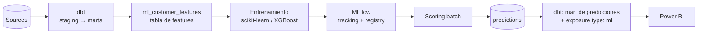
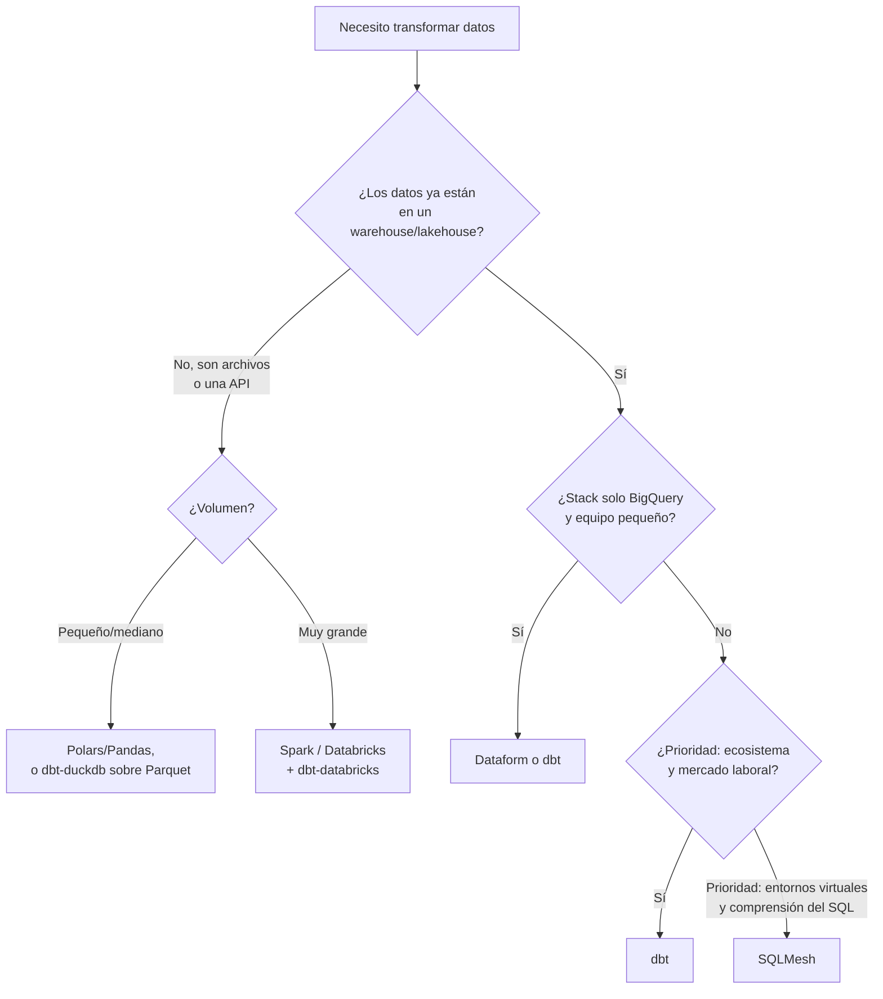

# 16 — Python Models, Ecosistema y Buenas Prácticas

## Python models

Desde dbt 1.3, un modelo puede ser un archivo `.py` que devuelve un DataFrame. dbt lo ejecuta **dentro de la plataforma** del warehouse (Snowpark en Snowflake, PySpark en Databricks, Dataproc en BigQuery) o, con `dbt-duckdb`, localmente.

```python
# models/marts/ml/ml_customer_features.py
import pandas as pd


def model(dbt, session):
    dbt.config(
        materialized="table",
        packages=["pandas", "numpy"],   # en Snowflake/Databricks: paquetes a instalar
        tags=["ml"],
    )

    customers = dbt.ref("dim_customers").df()   # DuckDB → DataFrame de Pandas
    orders = dbt.ref("fct_orders").df()

    ref_date = orders["order_date"].max()

    rfm = (
        orders.groupby("customer_id")
        .agg(
            recency_days=("order_date", lambda s: (ref_date - s.max()).days),
            frequency=("order_id", "nunique"),
            monetary=("total_amount", "sum"),
        )
        .reset_index()
    )

    for col in ["recency_days", "frequency", "monetary"]:
        rfm[f"{col}_score"] = pd.qcut(rfm[col].rank(method="first"), 5, labels=False) + 1
    rfm["recency_days_score"] = 6 - rfm["recency_days_score"]   # menos días = mejor

    return customers[["customer_id", "segment", "city"]].merge(rfm, on="customer_id", how="left")
```

### La API de `dbt` dentro de un Python model

| Llamada | Equivalente SQL |
|---|---|
| `dbt.ref("modelo")` | `{{ ref('modelo') }}` |
| `dbt.source("raw", "orders")` | `{{ source('raw', 'orders') }}` |
| `dbt.config(materialized="table")` | `{{ config(...) }}` |
| `dbt.config.get("clave")` | `config.get('clave')` |
| `dbt.this` | `{{ this }}` |
| `dbt.is_incremental` | `is_incremental()` |

Lo que devuelve `dbt.ref()` depende del adapter: un `DuckDBPyRelation` (`.df()` → Pandas, `.pl()` → Polars), un DataFrame de Snowpark o uno de PySpark. Tu función debe devolver un DataFrame que el adapter sepa escribir.

### Incremental en Python

```python
def model(dbt, session):
    dbt.config(materialized="incremental", unique_key="event_id")
    df = dbt.ref("stg_events")

    if dbt.is_incremental:
        max_ts = session.sql(f"select max(event_ts) from {dbt.this}").fetchone()[0]
        df = df.filter(f"event_ts > '{max_ts}'")

    return df
```

### ¿SQL o Python?

| Usa SQL cuando... | Usa Python cuando... |
|---|---|
| Joins, agregaciones, filtros, ventanas (90% de los casos) | Lógica que en SQL es torpe: estadística, `qcut`, fuzzy matching, parsing complejo |
| Quieres el máximo rendimiento del warehouse | Necesitas una librería (scikit-learn, scipy, un modelo pre-entrenado) |
| Lo mantendrán analistas | Lo mantendrá un equipo de DS |

Limitaciones: no se pueden usar macros Jinja dentro de `.py`, no hay `dbt show` tan inmediato, los unit tests solo cubren modelos SQL, y en warehouses en la nube suelen ser más lentos y caros que el SQL equivalente.

## dbt en el flujo de Machine Learning



dbt encaja como la **capa de features batch**:

- **Features como marts:** tablas `ml_*` con contratos (ver [[12 - Documentación, Lineage y Contratos]]) para que un cambio de esquema rompa en CI, no en el entrenamiento.
- **Point-in-time correctness:** usa snapshots (ver [[08 - Snapshots y SCD Tipo 2]]) para construir features "tal como se veían" en la fecha de cada etiqueta y evitar *data leakage*.
- **Exposures `type: ml`** para que el lineage llegue hasta el modelo.
- Leer las features desde Python:

```python
import duckdb
import mlflow
from sklearn.ensemble import GradientBoostingClassifier

df = duckdb.connect("prod.duckdb", read_only=True).sql(
    "select * from main_marts.ml_customer_features"
).df()

X, y = df.drop(columns=["customer_id", "churned"]), df["churned"]

with mlflow.start_run():
    mlflow.log_param("feature_table", "main_marts.ml_customer_features")
    model = GradientBoostingClassifier().fit(X, y)
    mlflow.sklearn.log_model(model, name="churn_model")
```

Para features en tiempo real o servidas online, dbt se combina con un feature store (ver [[43-Feature-Store-en-Profundidad]]); Feast, por ejemplo, puede leer tablas construidas por dbt como fuentes offline.

## Performance

| Técnica | Detalle |
|---|---|
| Materializa bien | Vistas apiladas → `table`; tablas enormes → `incremental` (ver [[06 - Materializaciones]]) |
| Particiona y clusteriza | `partition_by`/`cluster_by` por la columna que filtran los consumidores |
| Filtra temprano | Aplica `where` en staging/intermediate, no al final |
| Evita `select *` en marts | Los warehouses columnares cobran por columna leída |
| Reduce datos en dev | ` where order_date >= current_date - 30 ` o el flag `--sample` (dbt 1.10+) |
| Ajusta `threads` | Más hilos = más paralelismo, hasta saturar el warehouse |
| Warehouse por modelo | `snowflake_warehouse='XL'` solo para los modelos pesados |
| Busca los cuellos de botella | `run_results.json` ordenado por `execution_time`; el "critical path" del DAG define la duración total |
| Cuidado con ephemeral | Un ephemeral usado por 10 modelos se calcula 10 veces |
| `--empty` en CI | Valida SQL y esquemas sin procesar datos |

## Troubleshooting

| Error | Causa probable | Solución |
|---|---|---|
| `Could not find profile named 'x'` | `profile:` en `dbt_project.yml` no coincide con `profiles.yml` | Alinear nombres; `dbt debug` |
| `Model 'x' depends on a node named 'y' which was not found` | Typo en `ref()`, modelo deshabilitado o package no instalado | Revisar nombre; `dbt deps` |
| `Found a cycle` | A depende de B y B de A | Extraer la lógica común a un modelo intermedio |
| `Compilation Error ... 'None' has no attribute` | `run_query` sin guarda `` | Añadir la guarda (ver [[09 - Jinja y Macros]]) |
| Syntax error cerca de `;` | `;` al final del modelo | Quitarlo |
| Esquema `dbt_dmendez_marts` en vez de `marts` | Comportamiento por defecto de `generate_schema_name` | Sobrescribir la macro (ver [[04 - Models, ref() y el DAG]]) |
| Duplicados en incremental | Filtro `>=` con `append` o `unique_key` no único | Ver [[07 - Modelos Incrementales]] |
| Test `unique` falla tras un join | Fan-out: la tabla unida tiene varias filas por clave | Revisar el grano; agregar antes de unir |
| Contrato falla por tipo | El SELECT produce `double` y el contrato pide `numeric` | `cast()` explícito en el SELECT |
| Todo funciona en dev y falla en prod | Diferencias de datos, permisos o `target.name` | `dbt build --target prod -s modelo` en un entorno de prueba; revisar Jinja condicional |

Pasos de depuración, en orden:

1. Leer el error completo (dbt indica el archivo y la línea compilada).
2. `dbt compile -s modelo` y abrir `target/compiled/.../modelo.sql`.
3. Ejecutar ese SQL directamente en el warehouse (o `dbt show -s modelo`).
4. `dbt --debug run -s modelo` para ver cada query y su tiempo.
5. Revisar `logs/dbt.log`.

## Buenas prácticas, resumidas

**Estructura y estilo**
- Capas staging → intermediate → marts; `source()` solo en staging (ver [[13 - Estructura de Proyecto y Modelado]]).
- Un modelo, una responsabilidad. Si un modelo tiene 400 líneas, probablemente son tres modelos.
- CTEs de importación al inicio; un `select * from final` al cierre.
- Legibilidad antes que DRY: Jinja solo cuando elimina repetición real.
- Lint con SQLFluff y convenciones de nombres consistentes.

**Calidad**
- `unique` + `not_null` en toda clave primaria. Sin excepciones.
- Grano documentado y testeado en cada fact.
- Unit tests para lógica con bordes; contratos en modelos consumidos por otros.
- `dbt build`, nunca `run` sin tests en producción.

**Colaboración**
- Todo cambio por Pull Request con Slim CI.
- Esquemas personales en dev; nunca desarrollar contra prod.
- Descripciones y owners en los marts; exposures para dashboards y modelos de ML.

**Operación**
- Versiones fijadas; actualizaciones de dbt planificadas (leer las guías de migración).
- Freshness y alertas; manifest de prod publicado para CI.

## Comparativa: dbt vs. alternativas

| | **dbt** | **SQLMesh** | **Dataform** | **Stored procedures** | **Pandas/Polars scripts** |
|---|---|---|---|---|---|
| Lenguaje | SQL + Jinja (+ Python) | SQL con macros propias (+ Python); compatible con proyectos dbt | SQLX (SQL + JavaScript) | SQL procedural del warehouse | Python |
| Comprende el SQL | Solo con Fusion | Sí (parser SQLGlot): detecta cambios de columnas, transpila dialectos | Parcial | — | — |
| Entornos | Esquemas por target + `--defer` | Entornos virtuales (vistas sobre tablas versionadas): promoción a prod sin recomputar | Por workspace | Manual | Manual |
| Incrementales | Varias estrategias + microbatch | Incremental por rango de tiempo como concepto nativo | Sí | Manual | Manual |
| Testing | Data tests + unit tests | Audits + unit tests | Assertions | Manual | Pytest/Pandera |
| Ecosistema y comunidad | **El más grande**: packages, integraciones, empleos | Creciente (adquirido por Fivetran en 2025, que también se fusionó con dbt Labs) | Ligado a BigQuery / Google Cloud | — | Enorme, pero no específico de transformación |
| Warehouses | Prácticamente todos | La mayoría | Solo BigQuery | Uno | Cualquiera (datos en memoria) |
| Escala | La del warehouse | La del warehouse | BigQuery | La del warehouse | Limitada a la máquina (salvo Spark/Dask) |

### Cuándo elegir qué



Para tu ruta profesional (Data Analyst → Analytics/Data Engineering → ML), **dbt es la elección con más retorno**: es el estándar de facto en ofertas de Analytics Engineer y Data Engineer, y todo lo que aprendes (capas, tests, CI, modelado dimensional) es transferible a SQLMesh u otras herramientas.

### Ruta de aprendizaje sugerida

1. Proyecto local con `dbt-duckdb`: sources → staging → marts con `ref()` ([[02 - Instalación, Proyecto y profiles.yml]] a [[05 - Sources y Seeds]]).
2. Tests básicos y documentación ([[11 - Tests de Datos y Unit Tests]], [[12 - Documentación, Lineage y Contratos]]).
3. Materializaciones, incrementales y snapshots ([[06 - Materializaciones]] a [[08 - Snapshots y SCD Tipo 2]]).
4. Jinja, macros y packages ([[09 - Jinja y Macros]], [[10 - Packages]]).
5. Un proyecto en GitHub con Slim CI ([[15 - dbt en Producción - CI-CD y Orquestación]]).
6. Conectarlo a Power BI y a un modelo de ML con MLflow.
7. Certificación opcional: **dbt Analytics Engineering Certification**; cursos gratuitos en **learn.getdbt.com** (dbt Fundamentals).

## Ver también

- [[dbt/01 - Introducción y Arquitectura|01 - Introducción y Arquitectura]]
- [[13 - Estructura de Proyecto y Modelado]]
- [[15 - dbt en Producción - CI-CD y Orquestación]]
- [[04-Ingenieria-de-Datos]] (en `Machine Learning/`) — Spark, DuckDB, Polars y plataformas cloud
- [[43-Feature-Store-en-Profundidad]] (en `Machine Learning/`)
- `Python/MLflow/`, `Python/Polars/`, `Python/Pandas/`
